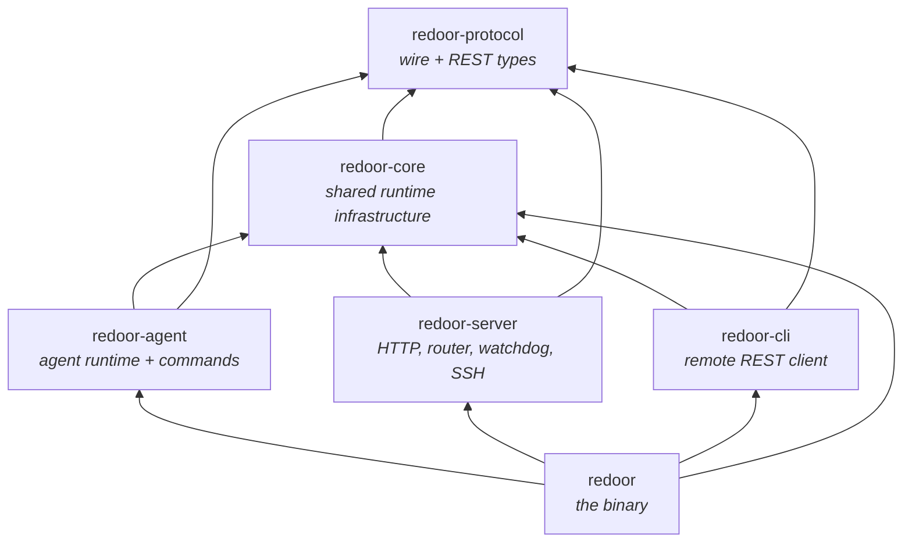
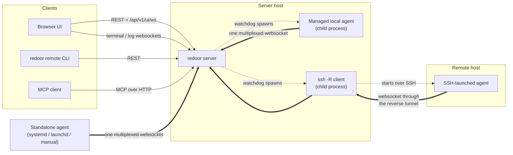
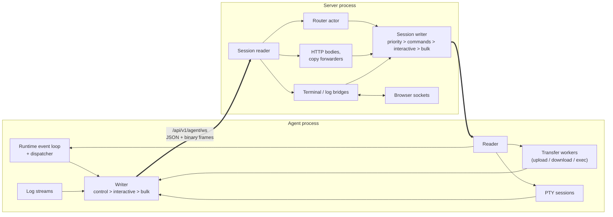
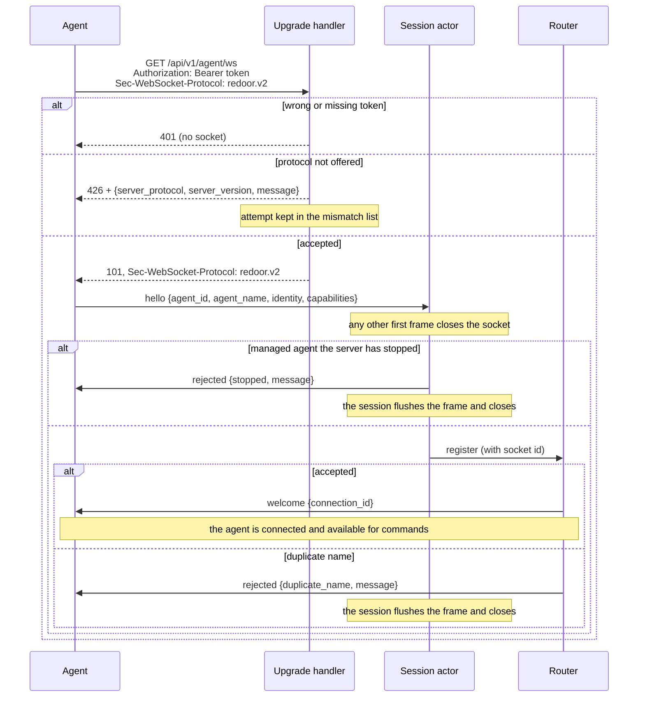
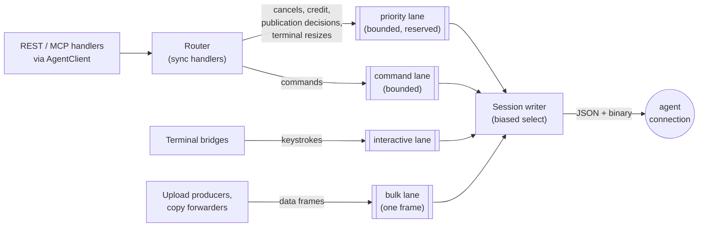
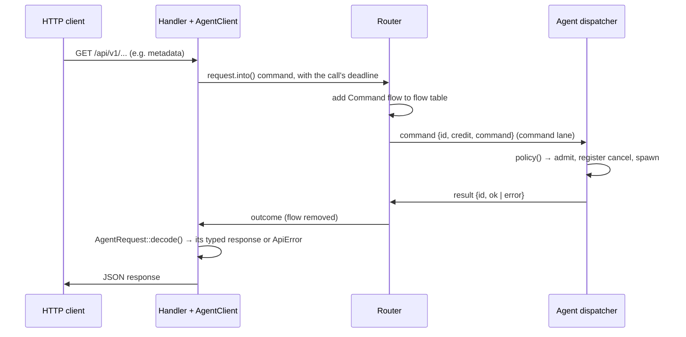
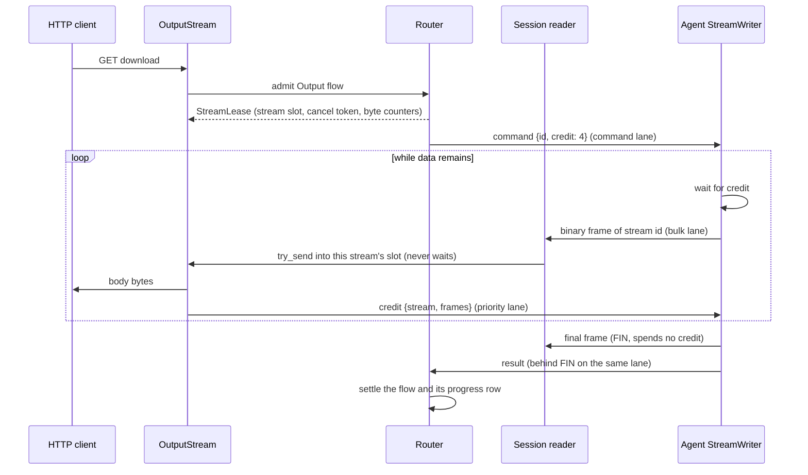
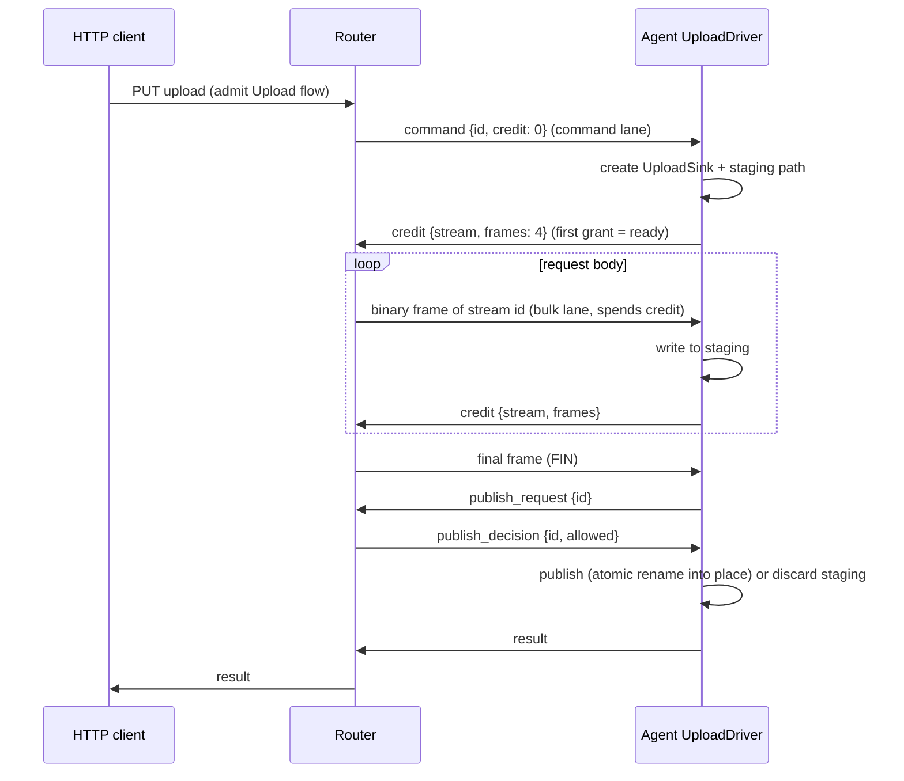
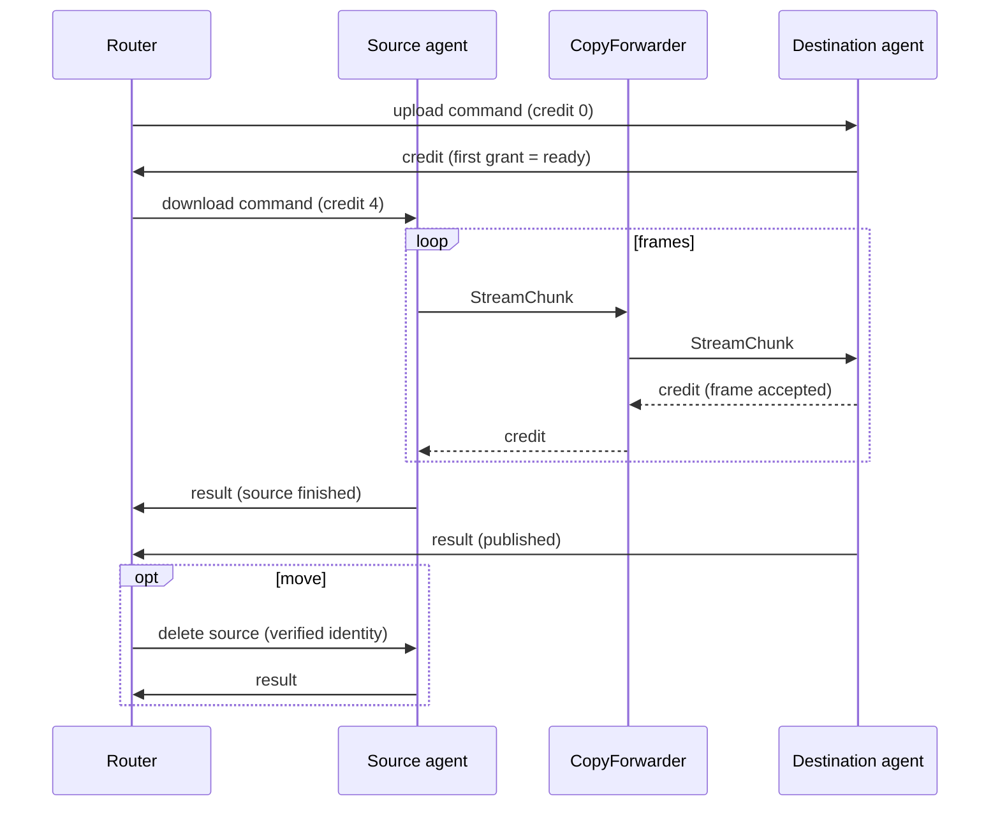
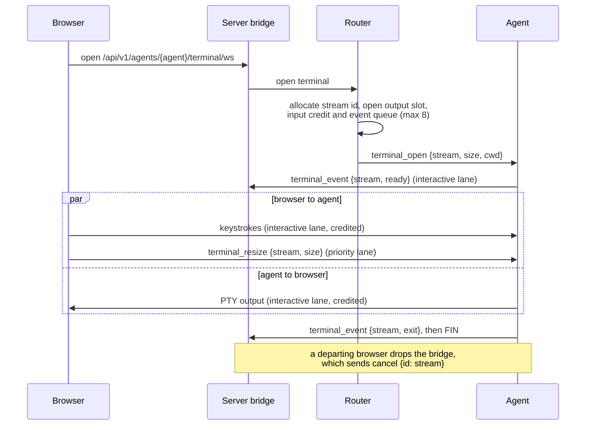

# Architecture

Redoor is a single `redoor` binary that plays several roles:

- **server**: REST API, browser UI, MCP endpoint and the websocket hub agents connect to
- **agent**: connects to a server and executes filesystem, exec, git, terminal and log commands on its host
- **remote CLI** (`redoor remote ...`): a REST client for scripting against a server
- **service management**: installs the server or agent as a systemd or launchd service

The Rust code is a cargo workspace under `crates/`. The roles live in separate crates so the
compiler enforces that agent and server code never depend on each other.

## Crates



Arrows point from a crate to what it depends on (the binary uses `redoor-protocol` only in its
tests). Dependencies only go downwards, and the three role crates in the middle are siblings
that cannot import each other.

### `redoor-protocol`

The contract between all parties, with no runtime dependencies (no tokio).

- `wire/`: the agent websocket protocol.
  - `handshake` holds the upgrade contract: the `redoor.v2` subprotocol, the agent endpoint
    path, the `426` body and the protocol-mismatch types the UI lists.
  - `ServerToAgent` and `AgentToServer` are the JSON control envelopes, one per direction,
    so each side's `match` is exhaustive. No frame except `hello` carries an agent id: the
    authenticated connection is the identity.
  - `Command` is the request payload. Its variants wrap the per-command structs in
    `request`, and each struct names its response type through the `AgentRequest` trait, so
    a command can only be answered (and decoded) as its own response.
  - `Command::policy()` is the single table that classifies every command: whether it
    streams bytes and in which direction, whether it is an upload, and how it is cancelled.
    Both the server and the agent read it, so they cannot disagree.
  - `stream` defines the binary frame (stream id, `FIN` flag, up to 64 KiB of payload)
    and the credit windows. `exec`, `log` and `terminal` hold the feature-specific wire types.
  - `registration` holds `AgentIdentity` and `AgentCapabilities`, which are flattened into
    the `hello` frame.
- `api/`: REST request and response types grouped by domain (agents, auth, files,
  transfers, git, mcp, ...).
- Types marked `#[ts(export)]` generate the TypeScript interfaces in `bindings/`, which the UI
  and the integration tests use, so REST JSON (and the wire types the browser shares, such as
  exec, log and terminal events) is checked from both sides. Agent-only wire types are
  covered by round-trip tests in the protocol crate and by the TypeScript fake agent.

### `redoor-core`

Infrastructure that more than one role needs:

- Configuration: serde parsing with a `validate()` pass, plus format-preserving edits through
  `toml_edit`.
- `RuntimeContext`: app name, `AppPaths` and websocket timeouts. It is built once in `main`
  and passed down instead of being read from process globals.
- Logging, behind a replaceable logger.
- Filesystem safety: `safe_fs` (including `safe_rm_all`), `atomic_rename`, `destination`
  (symlink-safe placement and merges) and `staging` (self-deleting hidden staging paths with
  atomic name reservation).
- `stream_credit`: the per-stream flow-control primitives that both the agent and server
  transfer paths use.
- Process helpers (`process`, `subprocess::run_checked`), `bounded_tail`, `paths::home()`,
  binary identity and build information.

### `redoor-agent`

The agent runtime and the implementation of every command.

- `runtime/`: the agent's single event loop.
  - `links`: the one connection and its three outbound lanes (control, interactive, bulk),
    with a generation number so events from a replaced socket are ignored.
  - `dispatch`: applies `Command::policy()` once per command. It handles admission,
    cancellation registration, spawning, logging and the response in one place.
  - `cancel`: a `CancellationToken` registry whose entries unregister themselves when dropped.
  - `responder`: typed outbound frames, including actions that must run after a frame was
    written (for example, re-exec after a restart response), and the `ResultLedger` that
    lets each request send exactly one result.
- `commands/`: filesystem, git, file search, content grep, metadata and host commands.
- `transfers/`: shared upload and download drivers.
  - `UploadSink` covers raw files, tar directories and file edits. `ByteSource` covers file
    ranges and tar archives.
  - Cancel and failure always run in the same order: stop, clean up, unregister, respond.
  - `stream` is the writer of every outgoing stream (request output, terminal and log
    streams), and the only place payload frames leave the agent. It waits for credit before
    each data frame; `FIN` spends none.
- `trash/`: a `TrashProvider` with freedesktop (Linux and Android/Termux), macOS and
  unsupported implementations.
- `platform/`: mounts, accounts and identity, which keeps OS-specific code out of the
  commands.
- `terminal`, `logs`: PTY sessions and log streaming, each on one stream of the connection.

### `redoor-server`

- `http/`: Axum routes, auth (sessions, PAM, machine and MCP tokens), the UI assets and MCP.
  - `agent_client`: `AgentClient::call` for any protocol request that is also an
    `AgentCall`, which adds its deadline; all deadlines are defined in one place.
  - `error.rs`: `ApiError`, which owns all HTTP status mapping.
  - `services/`: `TransferService` (copy and move), `OutputStream` (downloads, diffs, exec)
    and `AgentUpload`. REST and MCP handlers are thin adapters over these.
- `actors/`:
  - `agent_ws` (in `http/`): the agent endpoint. It checks the bearer token and the
    subprotocol before accepting the upgrade, and remembers protocol-mismatched attempts
    for `GET /api/v1/protocol-mismatches`.
  - `session`: one actor per agent connection. It requires `hello` as the first frame,
    asks the router to accept it and bridges the socket to the router through bounded lanes.
  - `lanes`: the typed outbound lanes to one agent (priority, command, interactive and bulk)
    and the write tickets that let a cancel withdraw a command that is still queued.
  - `router/`: the single owner of agent registrations and in-flight work.
    - `flows`: one table where every request belongs to exactly one flow (command, output
      stream, upload or copy). Every flow except a one-shot command has an explicit phase
      enum.
    - `streams`: the data path. Payload frames go from the connection reader to consumers
      (HTTP bodies, copy forwarders, terminal and log bridges) without passing through the
      router.
    - Every router handler is synchronous (enforced by `clippy::unused_async`), so the
      router mailbox never waits on a peer.
- `watchdog`: one dormant-until-started supervisor per managed agent, with restart backoff
  and generation counters.
- `ssh/`: preparing remote hosts (OS and architecture probe, binary install), launching
  agents through SSH reverse forwards, and the standalone `relay`.
- `startup`: `ServerConfig::resolve`, then `ServerRuntime::build`, then
  `serve_until_restart`.

### `redoor-cli`

The `redoor remote ...` client. It uses `reqwest` against the REST API with a saved session,
and covers device inventory, copy (including tar archives), exec and agent lifecycle. It only
depends on protocol and core, so it never links server or agent code.

### `redoor`

The binary crate. `main.rs` parses the CLI with clap and dispatches to a role. Every role
returns `anyhow::Result<ExitCode>`, and errors are printed once.

- `service/`: a `ServiceBackend` trait with systemd and launchd backends and one shared
  status formatter.
- `process_control` and `process_logs`: PID files, stopping processes and reading logs.
- The binary re-executes itself as the SSH askpass helper, so no second executable is
  shipped.

## Processes and connections



Agents always open the connections. The server never dials an agent, so an agent can run
behind NAT, on a phone (Termux) or on a host that is only reachable over SSH.

- **Standalone agents** are started by the user or a service manager, and connect to the
  server's `/api/v1/agent/ws` endpoint with the agent token.
- **Managed local agents** are `[[agents]]` entries in the server config. The server's
  watchdog spawns them as child processes and restarts them with backoff.
- **SSH-backed agents** are also watchdog-managed. The server runs `ssh -R
  <random-port>:<server>` and starts the agent on the remote host pointing at
  `ws://localhost:<random-port>/api/v1/agent/ws`. What looks like a local connection on the remote host
  reaches the server through the tunnel. The token is passed on SSH stdin and the password
  through askpass, so neither appears on a command line. `redoor agent relay` runs the same
  mechanism without a server, for agents of a remote server.
- **Browsers, the CLI and MCP clients** only use the REST API and browser websockets. They
  never talk to agents directly; the server translates each request into agent commands.

## One connection per agent



Each agent keeps exactly one websocket to the server, at `/api/v1/agent/ws`. It carries:

- **Text frames**: JSON control messages (`ServerToAgent` / `AgentToServer`).
- **Binary frames**: stream data. Each frame is an 8-byte stream id, a flags byte (only
  `FIN`, which marks a successful end; failures are reported by the result) and up to 64 KiB
  of payload. Unknown flags are rejected.

Every stream has a `u64` id allocated by the server from the same router-wide counter as
request ids, and each id is interpreted per connection:

| Stream | Opened by | Data direction |
|---|---|---|
| Request output (download, exec output, copy source) | `command` | agent → server |
| Request input (upload, edit, archive upload, copy destination) | `command` | server → agent |
| Terminal | `terminal_open` | both |
| Log stream | `log_stream_open` | agent → server (NDJSON events) |

**Scheduling.** Each side has one writer that drains its lanes in strict order:

1. control frames (on the server: the priority lane first, then the command lane);
2. interactive frames: terminal input and output;
3. bulk frames: every other stream. The bulk lane holds a single frame, so producers wait in
   the lane's fair queue and streams that have data and credit take turns frame by frame.

Because no data frame exceeds 64 KiB, a control frame never waits behind more than one data
frame. Terminal frames go ahead of downloads, so typing stays responsive during transfers.
One TCP connection does mean one congestion window: a slow network is shared by all of an
agent's streams. `tests/raw-upload-toxiproxy.test.ts` and `tests/stream-isolation.test.ts`
keep that trade-off visible.

**Readers never wait on consumers.** The reader on each side hands binary frames straight to
the stream's bounded queue with `try_send`. Every stream is credited, so an honest peer can
never overfill it; an overflow fails only that stream.

**Memory bound.** A stream's receiver holds at most its credit window plus the final frame:

| Stream | Window | Per connection |
|---|---|---|
| Output streams (downloads, exec) | 4 frames | at most 32 concurrent ordinary commands, enforced by the agent |
| Upload streams (uploads, edits, copy destinations) | 4 frames | at most 32, enforced by the server's router |
| Terminals | 16 frames each way | at most 8 |
| Log streams | 4 frames | at most 8 |

So the worst case per connection is roughly (streams × (window + 1) × 64 KiB), for example
8 terminals × 2 directions × 17 frames × 64 KiB ≈ 17 MiB for a terminal-heavy agent, and
64 × 5 × 64 KiB ≈ 20 MiB for transfers. On top of that the server reads one websocket
message at a time, capped at 32 MiB (a control result such as a git diff batch can be a few
MiB; data frames are at most 64 KiB).

## Stream credit

Credit is the per-stream flow control that lets many streams share one websocket without a
slow consumer holding up the others.

**Why it exists.** All of an agent's streams share one socket, and each side reads it with a
single reader. Without credit, a reader holding a frame for a consumer that is not ready (a
browser downloading slowly, a copy destination on a slow disk) has two bad choices. It can
buffer without limit, which breaks the memory bound. Or it can stop reading the socket, which
freezes every other stream and the control frames behind them. TCP flow control does not help,
because it applies to the whole connection, not to one stream.

**The rule.** A sender may put a data frame on a stream only when it holds credit for that
stream. One credit is one frame (up to 64 KiB). The receiver hands credit back with a
`credit {stream, frames}` control message once its consumer has drained frames.

- **Window**: the most credit a stream can hold. It is 4 frames for transfers and 16 for
  terminals. Grants beyond the window are clamped, so a misbehaving peer cannot make the other
  side buffer more.
- **Batching**: receivers return credit 2 frames at a time, so grants stay rare. The batch is
  smaller than the smallest window, so a drained receiver never holds back all of the sender's
  credit.
- **Grants travel as control frames** (on the server's priority lane and the agent's control
  lane), so they never wait behind data.
- **`FIN` is free.** The receive queue keeps one extra slot for it, so a stream can always end,
  and its result can always follow, even when the consumer has stalled.
- **Initial credit**: output streams get their full window in the command frame, so they start
  without a round trip. Uploads start at zero, and the agent's first grant also says that its
  worker is ready.

**What it buys.**

- The receiver knows the sender can have at most a window of frames outstanding, so the
  reader drops each frame into that stream's bounded queue with `try_send` and never waits.
  The socket keeps being read, so control stays responsive.
- Backpressure goes all the way through. A stalled HTTP client stalls only the agent producer
  for its own download. A copy returns credit to the source only after the destination has
  accepted the frame.
- Memory is bounded per stream at window + 1 frames (see the table above).
- Sending without credit is a protocol violation for that stream only. The stream fails and
  the connection keeps going.

**Where it lives.** `redoor-protocol::wire::stream` defines the window and batch constants and
which frames spend credit. `redoor-core::stream_credit` holds the two primitives. On the sender
side, `CreditGate` is a semaphore of frames: producers wait on it before each data frame, and
incoming grants refill it. On the receiver side, `CreditLedger` counts drained frames and
produces the batched grants. Each side has one place that spends credit: the agent's
`transfers/stream` writer, and the server's `OutboundStream`, which upload producers, copy
forwarders and terminal input all send through.

## Connection setup



- **Authentication and negotiation happen during the HTTP upgrade.** An unauthenticated or
  incompatible client never gets a socket, so no session state exists for it. The agent
  treats `401` (wrong token) and `426` (other protocol version) as fatal and exits with a
  clear log line instead of reconnecting forever.
- A refused protocol mismatch is remembered, so a standalone agent of another release shows
  up in the Devices view instead of only in its own logs. Managed local and SSH agents are
  always provisioned with the server's own binary, so they never mismatch. There is no
  compatibility with earlier protocols: an agent and a server must speak the same
  `redoor.vN`.
- **Identity is the connection.** `hello` is the only frame that names the agent; every later
  frame is attributed to the session that received it. A second `hello` closes the socket.
- **Request ids are interpreted per connection.** The server allocates them from one
  router-wide counter, and the router indexes flows by agent and request id, so a frame can
  only resolve work that was sent to its own connection.
- A reconnect of the same agent id replaces the old connection, which receives `evicted`
  and exits. A *different* agent id that claims a live agent's name is `rejected` with
  `duplicate_name`.
- Every connection gets a **socket id**. The router only accepts frames and unregistrations
  from an agent's *current* session, so a slow-dying old connection cannot remove the agent
  that replaced it after a reconnect.
- **Credit is mandatory.** Every stream in both directions is credited; there is no
  capability flag and no uncredited fallback.
- On the agent side, each link has a **generation** number. Timers and tasks from a replaced
  connection carry the old generation and are ignored.

## Server-side lanes to an agent



- Frames stay typed (`ServerToAgent`, `StreamChunk`) until the session writer encodes them.
  JSON is produced in exactly one place.
- The **command lane** is bounded. When it is full, new work is rejected instead of buffered,
  which is the server's admission control.
- Every frame that starts work (a command, `terminal_open`, `log_stream_open`) carries a
  **write ticket**. The writer claims the ticket just before writing the frame, and a cancel
  first tries to withdraw it. Whichever wins decides: a withdrawn frame is skipped and never
  reaches the agent, otherwise the cancel is sent after it. So a `cancel` can never overtake
  its command, and the agent needs no memory of early cancels.
- The **priority lane** is drained first. Cancels, credit grants and publication decisions
  never wait behind a backlog of commands or data. A cancel or publication decision that
  finds the lane momentarily full waits for capacity in a small task instead of being
  dropped.
- The router never awaits. `RouterHandle::send` reports `Full` and `Stopped` separately, and
  async callers use `send_async`, so router messages are never silently dropped.

## One-shot command



- `AgentClient::call` is the only way handlers talk to agents. The request type decides
  the response type: the agent encodes its answer with `Reply::of::<R>` (or
  `Reply::stream::<R>` for streaming commands), and the server decodes it with
  `R::decode`, so there are no "unexpected result type" branches. An agent
  error becomes an `ApiError` with the status of its `CommandErrorKind`; a payload that is
  not the request's response type is a protocol fault (500).
- When the caller gives up (the deadline passes or the HTTP client disconnects), the router
  drops the flow. If the command can be cancelled on the agent, the router also cancels it
  (see the request lifecycle below). A few commands, such as trash restore, are allowed to
  run to completion on purpose.

## Request lifecycle

Every request follows one ordered lifecycle on the connection:

```
server: command {id, credit, command}
agent:  binary frames of stream id ... binary frame with FIN     (streaming commands only)
agent:  result {id, ok: <response>} or result {id, error: {kind, message}}   (exactly one, last)
```

- **Exactly one result per request, always after its data.** An output stream's result
  (download, exec) is queued on the same agent lane as its data, behind `FIN`, so when the
  server sees the result the consumer already has every byte. An upload answers after its
  publication step, on the control lane. Flows therefore settle on the result alone; there is
  no separate "stream ended" event to reconcile with it. The agent's `ResultLedger` enforces
  the single result (a second one is a bug: a debug assertion, and dropped in release).
- **`FIN` means the data is complete.** A download or upload that fails or is cancelled ends
  without `FIN`, and its error result carries the reason. The server then fails the consumer
  after the frames it already queued, so an HTTP body aborts visibly instead of looking like a
  short file. Exec output always ends with `FIN`, because the output of a stopped process is
  still all the output there is; its result says how the process ended. Terminals and log
  streams have no result, so `FIN` is how they end: a terminal always sends it (after its
  exit or error event), and a log stream sends it unless the server canceled it, because
  then nobody listens any more.
- **Initial credit is in the command.** Output streams (downloads, exec) get their first
  window (`credit: 4`) in the command frame, so output starts without a round trip. Uploads
  start with `credit: 0`; the agent grants the first window when its worker is ready, and
  that first grant is the readiness signal.
- **Cancel.** The server sends `cancel {id}` on the priority lane only for a command that has
  been written (see write tickets above). A command still in the queue is withdrawn, never
  written, and answered by the router itself with a `canceled` error result. A written
  command's cancel is acknowledged by its normal result: kind `canceled` if the cancel
  stopped it, or the real result if it had already finished. The agent ignores cancels for
  requests it already answered and keeps no state for them.
- **Credit violations** are the only data-path event the router hears directly: the
  connection reader stops routing the stream, and the router fails the flow and cancels the
  agent's worker. The connection continues.

## Download, exec output and stream credit



- **Payload bypasses the router.** The router admits the stream and hands out a
  `StreamLease`. Frames then go from the session reader straight into that stream's
  bounded slot; the router only sees the result that follows them. Progress is read from the
  lease's byte counters.
- **Credit isolates streams.** The agent may have at most the granted number of frames in
  flight per stream (4 × 64 KiB). The server returns credit as the HTTP client drains the
  body. A stalled client therefore stalls only its own stream, while other downloads, exec
  output and copies from the same agent keep flowing. `tests/stream-isolation.test.ts`
  covers this.
- An agent that sends beyond its credit fails only that stream, not the connection
  (`tests/stream-credit.test.ts`).
- **Cancellation.** Dropping the `OutputStream` (the HTTP client went away) cancels the agent
  side. `FIN` and results never need credit, so a cancel acknowledgement can never get stuck
  behind unread data.
- Exec output uses the same path. The exit status is exec's result, ordered after the output
  `FIN`; the router publishes it on a separate watch channel, so the HTTP body emits it after
  the last output line. A timeout or cancel stops the process even while output waits for
  credit, and the result follows at once.

## Upload



- The agent's first credit grant confirms its worker exists before any body bytes are sent;
  the session reports it to the router as the upload's readiness.
- A producer that gives up (body longer than its `Content-Length`, client gone) never sends
  an error frame. The router cancels the agent's worker, which discards its staging and
  answers with its result.
- Content is written to a hidden **staging** path next to the destination. The path is
  reserved atomically and deletes itself if the upload is cancelled, fails or disconnects.
- **Publication is a separate step decided by the router.** This orders "publish" against a
  cancel that may be racing it. The router's answer is final, so a cancelled upload never
  replaces the destination, and an upload the router has accepted is never reported as
  cancelled.
- Raw file uploads, tar directory uploads and in-place file edits all use the same
  `UploadDriver`. They differ only in their `UploadSink`.

## Copy and move between agents



- A cross-agent copy is a source download and a destination upload joined by a
  `CopyForwarder` task. Credit is returned to the source only after the destination has
  accepted the frame. A slow destination therefore slows down only this copy, never either
  agent's other streams.
- The forwarder only relays data and `FIN`. A source that fails sends no `FIN`, and its
  error result makes the router fail the copy and cancel the destination worker, which
  discards its staging, so a partial copy is never published.
- A **move** is a copy followed by deleting the source (`CopyFlow` then
  `CopyPhase::DeletingSource`). The source is deleted only if its identity still matches what
  was copied. Once the source is being deleted, a destination disconnect no longer affects
  the result.
- A copy or move on a single agent runs entirely on that agent as a local worker. The server
  only follows its progress and can cancel it.

## Terminals and live logs



- Terminals and live log viewers are streams of the agent's one connection. The browser
  sockets stay as they are; the server bridge pairs a browser socket with a stream.
- Terminal frames use the interactive lane in both directions, so keystrokes and echoes do
  not queue behind bulk transfers. Lifecycle events travel on the same lane as the output,
  so an exit always follows the output that preceded it.
- Browser input that arrives before the PTY is ready is buffered, within a frame and byte
  limit. Setup is abandoned if the agent does not report ready in time.
- Live logs (`log_stream_open`) send NDJSON `LogEvent` lines that may span frames; the bridge
  reassembles each line (bounded by the largest valid event) and validates it before
  relaying it to the browser.
- Each connection allows at most 8 terminals and 8 log streams, enforced on both sides.

## Design rules

- **Memory is bounded.** All uploads, downloads and tar archives are streamed in 64 KiB frames
  through bounded channels. Nothing reads a whole file into memory.
- **Control stays responsive.** Payload never passes through the router mailbox, each
  writer sends control frames before data, and no data frame exceeds 64 KiB. Per-stream
  credit stops one slow consumer from blocking others.
- **One owner per concern.**
  - `Command::policy()` classifies commands.
  - The router owns flow lifecycle.
  - `ApiError` owns HTTP status mapping.
  - Each side's connection writer is the only place that encodes frames.
- **Stale events are ignored.** Socket ids on the server and generations on the agent mean a
  delayed event from a replaced connection can never affect its replacement.
- **The wire format is versioned.** Incompatible frame changes bump the `redoor.vN`
  subprotocol instead of carrying compatibility fallbacks; mismatched builds fail the upgrade
  with `426`. The integration tests speak the protocol through one shared fake agent
  (`tests/fake-agent.ts`), so a protocol change is made in one place on the test side.
