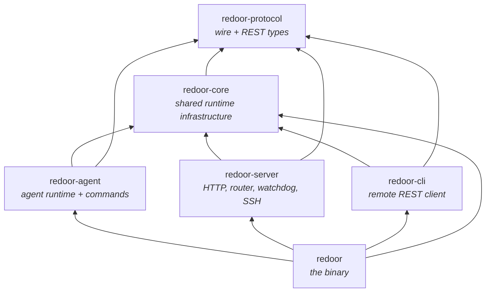
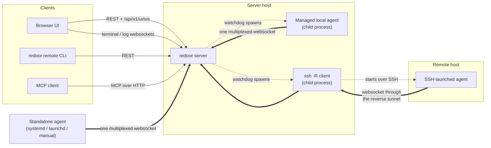
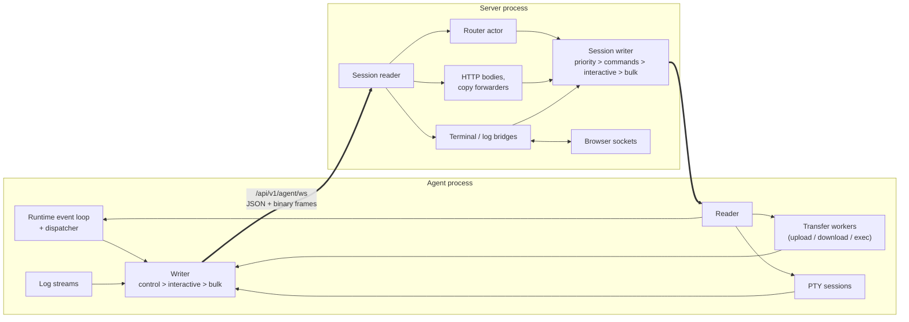
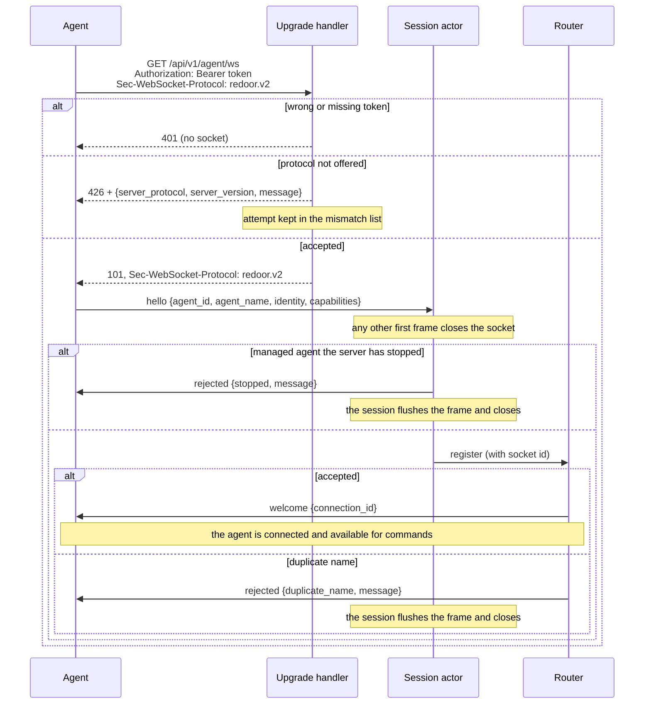
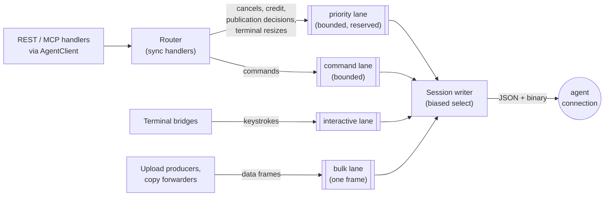
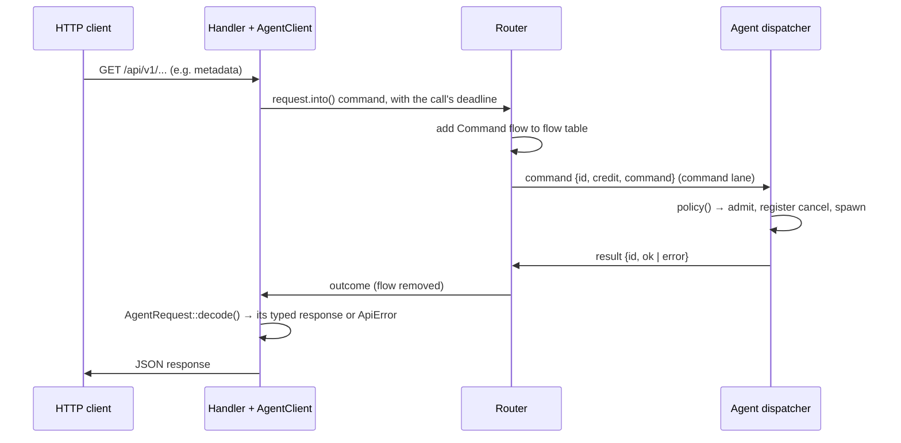
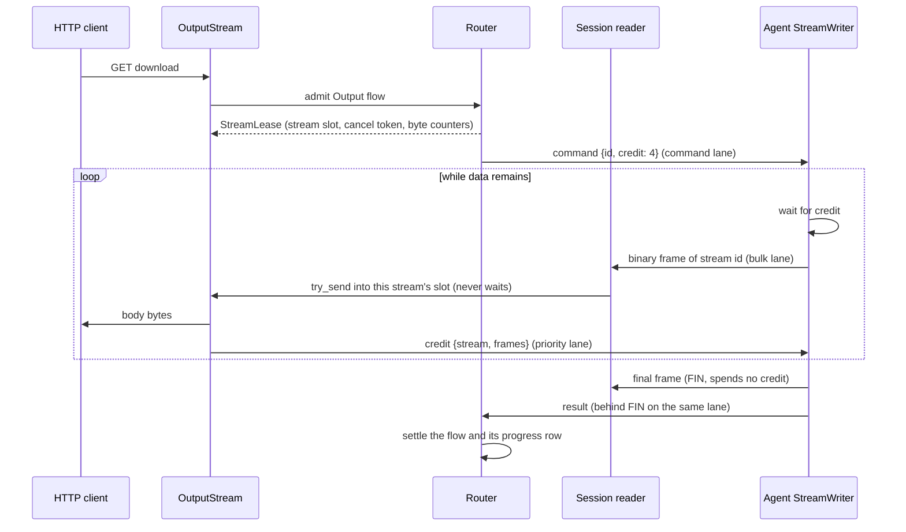
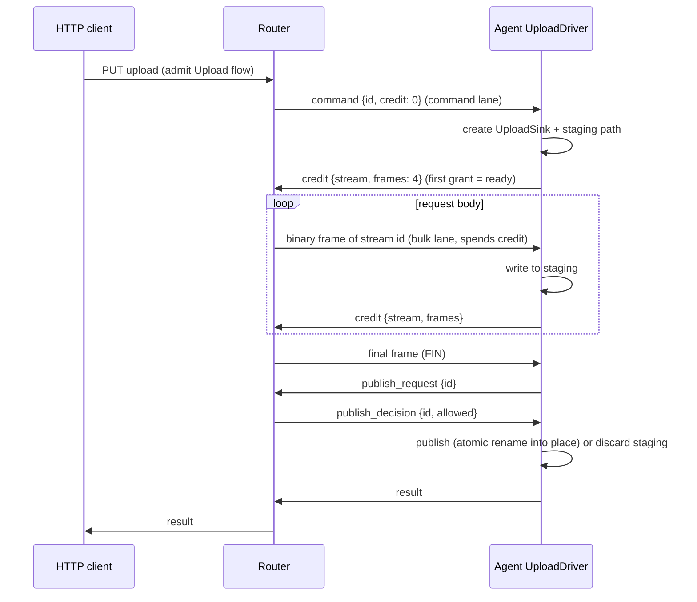
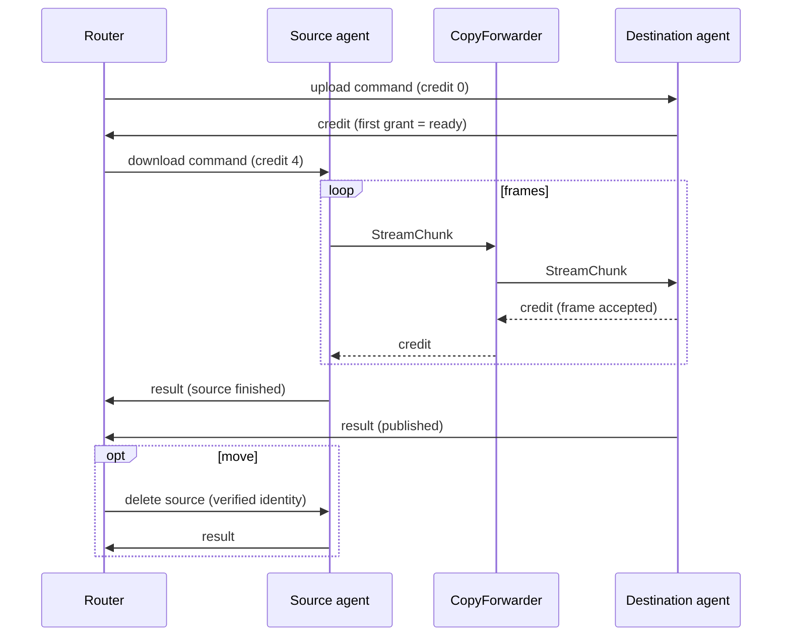
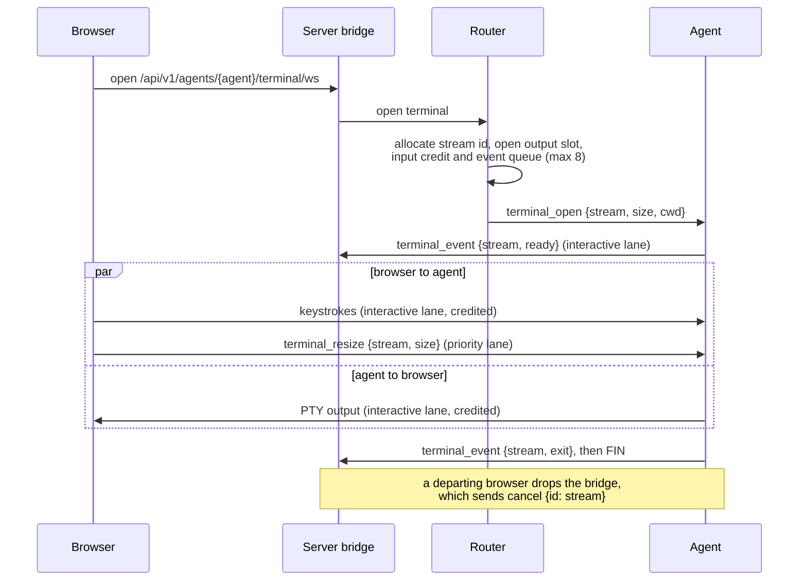

# Architecture

Redoor is a single `redoor` binary that plays several roles:

- **server**: REST API, browser UI, MCP endpoint and the websocket hub agents connect to
- **agent**: connects to a server and executes filesystem, exec, git, terminal and log commands on its host
- **remote CLI** (`redoor remote ...`): a REST client for scripting against a server, authenticated
  with an access token
- **service management**: installs the server or agent as a systemd or launchd service

The Rust code is a cargo workspace under `crates/`. The roles live in separate crates so the
compiler enforces that agent and server code never depend on each other.

## Crates



Arrows point from a crate to what it depends on (the binary uses `redoor-protocol` only in its
tests). Dependencies only go downwards, and the three role crates in the middle are siblings
that cannot import each other.

### `redoor-protocol`

The contract between all parties, with no runtime dependencies (no tokio).

- `wire/`: the agent websocket protocol.
  - `handshake` holds the upgrade contract: the `redoor.v2` subprotocol, the agent endpoint
    path, the `426` body and the protocol-mismatch types the UI lists.
  - `ServerToAgent` and `AgentToServer` are the JSON control envelopes, one per direction,
    so each side's `match` is exhaustive. No frame except `hello` carries an agent id: the
    authenticated connection is the identity.
  - `Command` is the request payload. Its variants wrap the per-command structs in
    `request`, and each struct names its response type through the `AgentRequest` trait, so
    a command can only be answered (and decoded) as its own response.
  - `Command::policy()` is the single table that classifies every command: whether it
    streams bytes and in which direction, whether it is an upload, and how it is cancelled.
    Both the server and the agent read it, so they cannot disagree.
  - `stream` defines the binary frame (stream id, `FIN` flag, up to 64 KiB of payload)
    and the credit windows. `exec`, `log` and `terminal` hold the feature-specific wire types.
  - `registration` holds `AgentIdentity` and `AgentCapabilities`, which are flattened into
    the `hello` frame.
- `api/`: REST request and response types grouped by domain (agents, auth, files,
  transfers, git, tokens, ...).
- Types marked `#[ts(export)]` generate the TypeScript interfaces in `bindings/`, which the UI
  and the integration tests use, so REST JSON (and the wire types the browser shares, such as
  exec, log and terminal events) is checked from both sides. Agent-only wire types are
  covered by round-trip tests in the protocol crate and by the TypeScript fake agent.

### `redoor-core`

Infrastructure that more than one role needs:

- Configuration: serde parsing with a `validate()` pass, plus format-preserving edits through
  `toml_edit`.
- `RuntimeContext`: app name, `AppPaths` and websocket timeouts. It is built once in `main`
  and passed down instead of being read from process globals.
- Logging, behind a replaceable logger.
- Filesystem safety: `safe_fs` (including `safe_rm_all`), `atomic_rename`, `destination`
  (symlink-safe placement and merges) and `staging` (self-deleting hidden staging paths with
  atomic name reservation).
- `stream_credit`: the per-stream flow-control primitives that both the agent and server
  transfer paths use.
- `directory_measurement`: one directory walk that yields content bytes and the predicted
  tar size. The agent uses it for download totals and directory sizes, and the CLI uses it
  for the percentage of local directory uploads.
- Process helpers (`process`, `subprocess::run_checked`), `bounded_tail`, `paths::home()`,
  binary identity and build information.

### `redoor-agent`

The agent runtime and the implementation of every command.

- `runtime/`: the agent's single event loop.
  - `links`: the one connection and its three outbound lanes (control, interactive, bulk),
    with a generation number so events from a replaced socket are ignored.
  - `dispatch`: applies `Command::policy()` once per command. It handles admission,
    cancellation registration, spawning, logging and the response in one place.
  - `cancel`: a `CancellationToken` registry whose entries unregister themselves when dropped.
  - `responder`: typed outbound frames, including actions that must run after a frame was
    written (for example, re-exec after a restart response), and the `ResultLedger` that
    lets each request send exactly one result.
- `commands/`: filesystem, git, file search, content grep, metadata and host commands.
- `transfers/`: shared upload and download drivers.
  - `UploadSink` covers raw files, tar directories and file edits. `ByteSource` covers file
    ranges and tar archives.
  - Cancel and failure always run in the same order: stop, clean up, unregister, respond.
  - `stream` is the writer of every outgoing stream (request output, terminal and log
    streams), and the only place payload frames leave the agent. It waits for credit before
    each data frame; `FIN` spends none.
- `trash/`: a `TrashProvider` with freedesktop (Linux and Android/Termux), macOS and
  unsupported implementations.
- `platform/`: mounts, accounts and identity, which keeps OS-specific code out of the
  commands.
- `terminal`, `logs`: PTY sessions and log streaming, each on one stream of the connection.

### `redoor-server`

- `http/`: Axum routes, auth (sessions, PAM), access tokens (`http/tokens`), access control
  (`http/access`), the UI assets and MCP.
  - `agent_client`: `AgentClient::call` for any protocol request that is also an
    `AgentCall`, which adds its deadline; all deadlines are defined in one place.
  - `error.rs`: `ApiError`, which owns all HTTP status mapping.
  - `services/`: `TransferService` (copy and move), `OutputStream` (downloads, diffs, exec)
    and `AgentUpload`. REST and MCP handlers are thin adapters over these.
- `actors/`:
  - `agent_ws` (in `http/`): the agent endpoint. It checks the bearer token and the
    subprotocol before accepting the upgrade, and remembers protocol-mismatched attempts
    for `GET /api/v1/protocol-mismatches`.
  - `session`: one actor per agent connection. It requires `hello` as the first frame,
    asks the router to accept it and bridges the socket to the router through bounded lanes.
  - `lanes`: the typed outbound lanes to one agent (priority, command, interactive and bulk)
    and the write tickets that let a cancel withdraw a command that is still queued.
  - `router/`: the single owner of agent registrations and in-flight work.
    - `flows`: one table where every request belongs to exactly one flow (command, output
      stream, upload or copy). Every flow except a one-shot command has an explicit phase
      enum.
    - `streams`: the data path. Payload frames go from the connection reader to consumers
      (HTTP bodies, copy forwarders, terminal and log bridges) without passing through the
      router.
    - Every router handler is synchronous (enforced by `clippy::unused_async`), so the
      router mailbox never waits on a peer.
- `watchdog`: one dormant-until-started supervisor per managed agent, with restart backoff
  and generation counters.
- `ssh/`: preparing remote hosts (OS and architecture probe, binary install), launching
  agents through SSH reverse forwards, and the standalone `relay`.
- `startup`: `ServerConfig::resolve`, then `ServerRuntime::build`, then
  `serve_until_restart`.

### `redoor-cli`

The `redoor remote ...` client. It uses `reqwest` against the REST API and authenticates
with an access token, and covers device inventory, copy (including tar archives), file
operations, exec and agent lifecycle (`login`, `logout`, `status`, `create-token`, `devices`,
`start`, `stop`, `exec`, `cp`, `mv`, `ls`, `stat`, `mkdir`, `rm`, `find`, `grep`). It only
depends on protocol and core, so it never links server or agent code.

The CLI and MCP offer roughly the same device operations. The difference is local files:
only the CLI streams files and tar archives between the local machine and a device; MCP
keeps file content inline and capped at 64 KiB.

- `credentials`: the token saved by `login` in `<data_dir>/remote-credentials.json` (0600,
  in a 0700 directory, never followed through symlinks). `REDOOR_REMOTE_SERVER` plus
  `REDOOR_REMOTE_TOKEN` override it, so CI jobs and AI agents need no saved login.
- `login`: `LoginFlow` behind a `Prompter` trait (dialoguer on a terminal, scripted answers
  in tests). Every prompt also has a flag, so the same command works in scripts.
- `progress`: the single redrawn stderr line of `cp`, shown only when stderr is a terminal so
  logs and pipes get no carriage-return noise. Directory transfers count file content bytes
  rather than tar or gzip bytes, because that is what the directory sizes (a local
  `directory_measurement` walk, or the agent's `directory-size` endpoint) report. The size
  walk runs beside the transfer, so a large tree starts moving at once and the percentage
  appears when the walk finishes.

### `redoor`

The binary crate. `main.rs` parses the CLI with clap and dispatches to a role. Every role
returns `anyhow::Result<ExitCode>`, and errors are printed once.

- `service/`: a `ServiceBackend` trait with systemd and launchd backends and one shared
  status formatter.
- `process_control` and `process_logs`: PID files, stopping processes and reading logs.
- The binary re-executes itself as the SSH askpass helper, so no second executable is
  shipped.

## Processes and connections



Agents always open the connections. The server never dials an agent, so an agent can run
behind NAT, on a phone (Termux) or on a host that is only reachable over SSH.

- **Standalone agents** are started by the user or a service manager, and connect to the
  server's `/api/v1/agent/ws` endpoint with the agent token.
- **Managed local agents** are `[[agents]]` entries in the server config. The server's
  watchdog spawns them as child processes and restarts them with backoff.
- **SSH-backed agents** are also watchdog-managed. The server runs `ssh -R
  <random-port>:<server>` and starts the agent on the remote host pointing at
  `ws://localhost:<random-port>/api/v1/agent/ws`. What looks like a local connection on the remote host
  reaches the server through the tunnel. The token is passed on SSH stdin and the password
  through askpass, so neither appears on a command line. `redoor agent relay` runs the same
  mechanism without a server, for agents of a remote server.
- **Browsers, the CLI and MCP clients** only use the REST API, the `/mcp` endpoint and browser
  websockets. They never talk to agents directly; the server translates each request into
  agent commands.

## One connection per agent



Each agent keeps exactly one websocket to the server, at `/api/v1/agent/ws`. It carries:

- **Text frames**: JSON control messages (`ServerToAgent` / `AgentToServer`).
- **Binary frames**: stream data. Each frame is an 8-byte stream id, a flags byte (only
  `FIN`, which marks a successful end; failures are reported by the result) and up to 64 KiB
  of payload. Unknown flags are rejected.

Every stream has a `u64` id allocated by the server from the same router-wide counter as
request ids, and each id is interpreted per connection:

| Stream | Opened by | Data direction |
|---|---|---|
| Request output (download, exec output, copy source) | `command` | agent → server |
| Request input (upload, edit, archive upload, copy destination) | `command` | server → agent |
| Terminal | `terminal_open` | both |
| Log stream | `log_stream_open` | agent → server (NDJSON events) |

**Scheduling.** Each side has one writer that drains its lanes in strict order:

1. control frames (on the server: the priority lane first, then the command lane);
2. interactive frames: terminal input and output;
3. bulk frames: every other stream. The bulk lane holds a single frame, so producers wait in
   the lane's fair queue and streams that have data and credit take turns frame by frame.

Because no data frame exceeds 64 KiB, a control frame never waits behind more than one data
frame. Terminal frames go ahead of downloads, so typing stays responsive during transfers.
One TCP connection does mean one congestion window: a slow network is shared by all of an
agent's streams. `tests/raw-upload-toxiproxy.test.ts` and `tests/stream-isolation.test.ts`
keep that trade-off visible.

**Readers never wait on consumers.** The reader on each side hands binary frames straight to
the stream's bounded queue with `try_send`. Every stream is credited, so an honest peer can
never overfill it; an overflow fails only that stream.

**Memory bound.** A stream's receiver holds at most its credit window plus the final frame:

| Stream | Window | Per connection |
|---|---|---|
| Output streams (downloads, exec) | 4 frames | at most 32 concurrent ordinary commands, enforced by the agent |
| Upload streams (uploads, edits, copy destinations) | 4 frames | at most 32, enforced by the server's router |
| Terminals | 16 frames each way | at most 8 |
| Log streams | 4 frames | at most 8 |

So the worst case per connection is roughly (streams × (window + 1) × 64 KiB), for example
8 terminals × 2 directions × 17 frames × 64 KiB ≈ 17 MiB for a terminal-heavy agent, and
64 × 5 × 64 KiB ≈ 20 MiB for transfers. On top of that the server reads one websocket
message at a time, capped at 32 MiB (a control result such as a git diff batch can be a few
MiB; data frames are at most 64 KiB).

## Stream credit

Credit is the per-stream flow control that lets many streams share one websocket without a
slow consumer holding up the others.

**Why it exists.** All of an agent's streams share one socket, and each side reads it with a
single reader. Without credit, a reader holding a frame for a consumer that is not ready (a
browser downloading slowly, a copy destination on a slow disk) has two bad choices. It can
buffer without limit, which breaks the memory bound. Or it can stop reading the socket, which
freezes every other stream and the control frames behind them. TCP flow control does not help,
because it applies to the whole connection, not to one stream.

**The rule.** A sender may put a data frame on a stream only when it holds credit for that
stream. One credit is one frame (up to 64 KiB). The receiver hands credit back with a
`credit {stream, frames}` control message once its consumer has drained frames.

- **Window**: the most credit a stream can hold. It is 4 frames for transfers and 16 for
  terminals. Grants beyond the window are clamped, so a misbehaving peer cannot make the other
  side buffer more.
- **Batching**: receivers return credit 2 frames at a time, so grants stay rare. The batch is
  smaller than the smallest window, so a drained receiver never holds back all of the sender's
  credit.
- **Grants travel as control frames** (on the server's priority lane and the agent's control
  lane), so they never wait behind data.
- **`FIN` is free.** The receive queue keeps one extra slot for it, so a stream can always end,
  and its result can always follow, even when the consumer has stalled.
- **Initial credit**: output streams get their full window in the command frame, so they start
  without a round trip. Uploads start at zero, and the agent's first grant also says that its
  worker is ready.

**What it buys.**

- The receiver knows the sender can have at most a window of frames outstanding, so the
  reader drops each frame into that stream's bounded queue with `try_send` and never waits.
  The socket keeps being read, so control stays responsive.
- Backpressure goes all the way through. A stalled HTTP client stalls only the agent producer
  for its own download. A copy returns credit to the source only after the destination has
  accepted the frame.
- Memory is bounded per stream at window + 1 frames (see the table above).
- Sending without credit is a protocol violation for that stream only. The stream fails and
  the connection keeps going.

**Where it lives.** `redoor-protocol::wire::stream` defines the window and batch constants and
which frames spend credit. `redoor-core::stream_credit` holds the two primitives. On the sender
side, `CreditGate` is a semaphore of frames: producers wait on it before each data frame, and
incoming grants refill it. On the receiver side, `CreditLedger` counts drained frames and
produces the batched grants. Each side has one place that spends credit: the agent's
`transfers/stream` writer, and the server's `OutboundStream`, which upload producers, copy
forwarders and terminal input all send through.

## Connection setup



- **Authentication and negotiation happen during the HTTP upgrade.** An unauthenticated or
  incompatible client never gets a socket, so no session state exists for it. The agent
  treats `401` (wrong token) and `426` (other protocol version) as fatal and exits with a
  clear log line instead of reconnecting forever.
- A refused protocol mismatch is remembered, so a standalone agent of another release shows
  up in the Devices view instead of only in its own logs. Managed local and SSH agents are
  always provisioned with the server's own binary, so they never mismatch. There is no
  compatibility with earlier protocols: an agent and a server must speak the same
  `redoor.vN`.
- **Identity is the connection.** `hello` is the only frame that names the agent; every later
  frame is attributed to the session that received it. A second `hello` closes the socket.
- **Request ids are interpreted per connection.** The server allocates them from one
  router-wide counter, and the router indexes flows by agent and request id, so a frame can
  only resolve work that was sent to its own connection.
- A reconnect of the same agent id replaces the old connection, which receives `evicted`
  and exits. A *different* agent id that claims a live agent's name is `rejected` with
  `duplicate_name`.
- Every connection gets a **socket id**. The router only accepts frames and unregistrations
  from an agent's *current* session, so a slow-dying old connection cannot remove the agent
  that replaced it after a reconnect.
- **Credit is mandatory.** Every stream in both directions is credited; there is no
  capability flag and no uncredited fallback.
- On the agent side, each link has a **generation** number. Timers and tasks from a replaced
  connection carry the old generation and are ignored.

## Managed agent lifecycle

Managed agents are the `[[agents]]` entries in the server config: local child processes and
SSH-backed agents. The server's watchdog runs them. Standalone agents manage themselves.

- **States** are `AgentConnectionStatus`. A managed agent moves between `Stopped`, `Starting`
  and `Connected`. `Disconnected` is only used for standalone agents. A managed agent whose
  socket drops goes back to `Starting`, because the watchdog is already bringing it back.
- **Dormant until started.** At startup every managed agent gets a supervisor in `Stopped`,
  and nothing is spawned until the user starts it. So a server restart never launches local
  or remote processes on its own.
- **Actions**:

  | Action | Endpoint | Effect |
  |---|---|---|
  | Start | `POST /api/v1/agents/{agent}/start` | Marks the agent desired-running; the supervisor spawns it |
  | Disconnect | `POST /api/v1/agents/{agent}/shutdown` | Cancels provisioning or backoff, kills and reaps the child, evicts its socket |
  | Retry start | `POST /api/v1/agents/{agent}/retry-start` | Abandons the current attempt and starts a fresh one with the backoff reset |
  | Restart | `POST /api/v1/agents/{agent}/restart` | Not a watchdog action: the agent re-executes itself, so it works for any connected agent |

- **Supervision.** While an agent is desired-running, the watchdog restarts it when spawning or
  provisioning fails, when the child exits and when its heartbeat goes stale. The backoff
  starts at 1 s and doubles up to 30 s, and resets after 30 s of stable connection. The
  watchdog never gives up. The latest error is shown as the agent's `connection_issue` while
  it stays `Starting`.
- **SSH provisioning runs on every attempt**, so the UI always shows current results. It
  probes the OS and architecture and reuses the remote binary if its version matches.
  Otherwise it uploads the matching release from the local cache. Each step is published as
  `provisioning_status`, which the UI lists while the agent starts. The ssh child holds the
  remote agent's stdin, so killing ssh makes the remote agent exit (`--exit-on-stdin-eof`).
- **A stop wins every race.** Every start, shutdown and retry bumps an attempt generation, and
  the router commits a registration only if its generation is still current. An agent that
  connects while its entry is not desired-running gets `rejected` with `stopped` and exits.
  Without this, a `hello` that was already in flight, or a remote process that outlived its
  ssh client, would reconnect and silently undo the user's stop. Socket ids likewise filter
  out late disconnect and stale events from replaced sockets.
- **Config edits apply at runtime.** Adding an agent creates a new dormant supervisor.
  Editing or deleting one stops the agent, rewrites the config file (preserving its
  formatting) and replaces the supervisor, so an edited agent comes back as `Stopped`. Changes
  made to `config.toml` by hand take effect on the next server restart.
- **Server restart** (`POST /api/v1/server/restart`) validates the config first. It then
  stops every managed child before re-executing, because `exec` would otherwise leave them
  orphaned. Standalone agents simply reconnect.

## Server-side lanes to an agent



- Frames stay typed (`ServerToAgent`, `StreamChunk`) until the session writer encodes them.
  JSON is produced in exactly one place.
- The **command lane** is bounded. When it is full, new work is rejected instead of buffered,
  which is the server's admission control.
- Every frame that starts work (a command, `terminal_open`, `log_stream_open`) carries a
  **write ticket**. The writer claims the ticket just before writing the frame, and a cancel
  first tries to withdraw it. Whichever wins decides: a withdrawn frame is skipped and never
  reaches the agent, otherwise the cancel is sent after it. So a `cancel` can never overtake
  its command, and the agent needs no memory of early cancels.
- The **priority lane** is drained first. Cancels, credit grants and publication decisions
  never wait behind a backlog of commands or data. A cancel or publication decision that
  finds the lane momentarily full waits for capacity in a small task instead of being
  dropped.
- The router never awaits. `RouterHandle::send` reports `Full` and `Stopped` separately, and
  async callers use `send_async`, so router messages are never silently dropped.

## Flows

The router tracks all in-flight agent work as **flows**. Every request the router sends to an
agent belongs to exactly one flow, and all flows live in one `FlowTable`.

| Flow | What it is | Phases |
|---|---|---|
| `Command` | A one-shot request whose caller waits for the result | none |
| `Output` | A download or exec output streaming to a consumer | `Streaming`, `Canceling` |
| `Upload` | An upload, archive upload or file edit into one agent | `AwaitingReady`, `Streaming`, `Committing` (edits only), `Publishing`, `Canceling` |
| `Copy` | A copy or move, on one agent or across two | `Verifying`, `SettlingPartial`, `Local`, `Remote`, `DeletingSource` |

- **Why one table.** A frame's request id resolves through a single index instead of probing
  several registries. Explicit phase enums replace combinations of booleans, so impossible
  states such as "canceling and publishing" cannot be represented. Phases also decide what
  can still be canceled. An upload in `Committing` or `Publishing` and a move in
  `DeletingSource` have passed the point of no return.
- **Keys.** Flows are indexed by agent and request id, so a frame can only resolve work that
  was sent to its own agent. One flow can answer several request ids at once (a cross-agent
  copy has one per agent), and it gets fresh ids when it changes phase.
- Terminals and log streams are not flows. They are per-connection streams with no result.
- **A flow settles exactly once**, and it is removed from the table when it does. A flow
  settles when:
  - the agent's result arrives. This is the normal case, and the result always comes after
    the stream data.
  - the caller gives up. A dropped `AgentClient` call or HTTP body tells the router, which
    removes a command flow at once. Stream flows move to `Canceling` until the agent
    acknowledges the cancel.
  - the user cancels or pauses it by transfer id.
  - the agent's connection is lost. `fail_agent_flows` takes out every flow that depends on
    that agent and fails each one. Which agents a copy depends on changes with its phase.
    Once the source has sent everything, losing it no longer fails the copy. Once a move is
    deleting its source, losing the destination no longer matters.
  - its stream violates credit.
- Callers learn the outcome through oneshot channels (command results, upload readiness and
  completion, pause confirmation) or a watch channel (exec exit status).
- **Leases.** A streaming flow holds a `StreamLease`: a cancellation token, byte counters and
  a fault slot, shared with the data path. This is what lets payload bypass the router. The
  router cancels or fails a stream through its lease and reads progress from its counters,
  and no frame passes through its mailbox.
- **Progress rows are separate from flows.** Downloads, uploads and copies also get a row in
  the transfer progress store, keyed by a public `TransferId`. Rows outlive their flows as
  history (see browser live updates below).
- **Admission.** The router allows at most 32 uploads per connection, counting copies into
  that agent. It refuses a second copy to a destination path that already has one running,
  and it rejects new work when the command lane is full.

## One-shot command



- `AgentClient::call` is the only way handlers talk to agents. The request type decides
  the response type: the agent encodes its answer with `Reply::of::<R>` (or
  `Reply::stream::<R>` for streaming commands), and the server decodes it with
  `R::decode`, so there are no "unexpected result type" branches. An agent
  error becomes an `ApiError` with the status of its `CommandErrorKind`; a payload that is
  not the request's response type is a protocol fault (500).
- When the caller gives up (the deadline passes or the HTTP client disconnects), the router
  drops the flow. If the command can be cancelled on the agent, the router also cancels it
  (see the request lifecycle below). A few commands, such as trash restore, are allowed to
  run to completion on purpose.

## Request lifecycle

Every request follows one ordered lifecycle on the connection:

```
server: command {id, credit, command}
agent:  binary frames of stream id ... binary frame with FIN     (streaming commands only)
agent:  result {id, ok: <response>} or result {id, error: {kind, message}}   (exactly one, last)
```

- **Exactly one result per request, always after its data.** An output stream's result
  (download, exec) is queued on the same agent lane as its data, behind `FIN`, so when the
  server sees the result the consumer already has every byte. An upload answers after its
  publication step, on the control lane. Flows therefore settle on the result alone; there is
  no separate "stream ended" event to reconcile with it. The agent's `ResultLedger` enforces
  the single result (a second one is a bug: a debug assertion, and dropped in release).
- **`FIN` means the data is complete.** A download or upload that fails or is cancelled ends
  without `FIN`, and its error result carries the reason. The server then fails the consumer
  after the frames it already queued, so an HTTP body aborts visibly instead of looking like a
  short file. Exec output always ends with `FIN`, because the output of a stopped process is
  still all the output there is; its result says how the process ended. Terminals and log
  streams have no result, so `FIN` is how they end: a terminal always sends it (after its
  exit or error event), and a log stream sends it unless the server canceled it, because
  then nobody listens any more.
- **Initial credit is in the command.** Output streams (downloads, exec) get their first
  window (`credit: 4`) in the command frame, so output starts without a round trip. Uploads
  start with `credit: 0`; the agent grants the first window when its worker is ready, and
  that first grant is the readiness signal.
- **Cancel.** The server sends `cancel {id}` on the priority lane only for a command that has
  been written (see write tickets above). A command still in the queue is withdrawn, never
  written, and answered by the router itself with a `canceled` error result. A written
  command's cancel is acknowledged by its normal result: kind `canceled` if the cancel
  stopped it, or the real result if it had already finished. The agent ignores cancels for
  requests it already answered and keeps no state for them.
- **Credit violations** are the only data-path event the router hears directly: the
  connection reader stops routing the stream, and the router fails the flow and cancels the
  agent's worker. The connection continues.

## Download, exec output and stream credit



- **Payload bypasses the router.** The router admits the stream and hands out a
  `StreamLease`. Frames then go from the session reader straight into that stream's
  bounded slot; the router only sees the result that follows them. Progress is read from the
  lease's byte counters.
- **Credit isolates streams.** The agent may have at most the granted number of frames in
  flight per stream (4 × 64 KiB). The server returns credit as the HTTP client drains the
  body. A stalled client therefore stalls only its own stream, while other downloads, exec
  output and copies from the same agent keep flowing. `tests/stream-isolation.test.ts`
  covers this.
- An agent that sends beyond its credit fails only that stream, not the connection
  (`tests/stream-credit.test.ts`).
- **Cancellation.** Dropping the `OutputStream` (the HTTP client went away) cancels the agent
  side. `FIN` and results never need credit, so a cancel acknowledgement can never get stuck
  behind unread data.
- Exec output uses the same path. The exit status is exec's result, ordered after the output
  `FIN`; the router publishes it on a separate watch channel, so the HTTP body emits it after
  the last output line. A timeout or cancel stops the process even while output waits for
  credit, and the result follows at once.

## Upload



- The agent's first credit grant confirms its worker exists before any body bytes are sent;
  the session reports it to the router as the upload's readiness.
- A producer that gives up (body longer than its `Content-Length`, client gone) never sends
  an error frame. The router cancels the agent's worker, which discards its staging and
  answers with its result.
- Content is written to a hidden **staging** path next to the destination. The path is
  reserved atomically and deletes itself if the upload is cancelled, fails or disconnects.
- **Publication is a separate step decided by the router.** This orders "publish" against a
  cancel that may be racing it. The router's answer is final, so a cancelled upload never
  replaces the destination, and an upload the router has accepted is never reported as
  cancelled.
- Raw file uploads, tar directory uploads and in-place file edits all use the same
  `UploadDriver`. They differ only in their `UploadSink`.
- Raw file and tar directory uploads both default to `on_existing=error`. Replacing or merging
  into an existing entry must be requested explicitly, so no client overwrites by accident.

## Copy and move between agents



- A cross-agent copy is a source download and a destination upload joined by a
  `CopyForwarder` task. Credit is returned to the source only after the destination has
  accepted the frame. A slow destination therefore slows down only this copy, never either
  agent's other streams.
- The forwarder only relays data and `FIN`. A source that fails sends no `FIN`, and its
  error result makes the router fail the copy and cancel the destination worker. A partial
  copy is never published. The destination either discards its staging, or, for a
  resumable file copy, keeps it as a partial (see the next section).
- A **move** is a copy followed by deleting the source (`CopyFlow` then
  `CopyPhase::DeletingSource`). The source is deleted only if its identity still matches what
  was copied. Once the source is being deleted, a destination disconnect no longer affects
  the result.
- A copy or move on a single agent runs entirely on that agent as a local worker. The server
  only follows its progress and can cancel it.

## Resuming copies and moves

An interrupted file copy or move keeps what it has already written, so the next attempt
continues from there instead of from byte zero. This covers regular files: copies and moves
between agents, copies on one agent, and the copy-and-delete fallback of a move on one agent.
Directory archives start over.

- **The partial is the only resume state.** The destination writes into a hidden partial file
  next to the destination path (`.<name>.redoor-partial-<hash>`). It keeps a manifest for that
  file under `partials/` in the agent's data dir. Both are made durable before any payload
  arrives. The server keeps no transfer database, so resuming works across server, agent and
  machine restarts, including a crash of the destination agent.
- **The server signs the manifest.** The manifest records:
  - the source agent, path and file identity
  - the destination
  - the operation and the conflict policy

  The server signs these fields with a BLAKE3 keyed hash, using a key only it holds
  (`partials-signing-key` in the server data dir). The agent stores the signature but can
  neither check nor produce one. Without the signature, a compromised destination agent could
  write a manifest naming any file on any other agent. A single Resume click would then copy
  that file to the attacker, or, for a move, delete it. The server also checks that the
  manifest names the agent that returned it as its destination. The shared agent token is not
  used as the key, because every agent knows it.
- **Only a verified prefix is reused.** The server rounds the partial's length down to whole
  64 MiB segments.
  - **Across agents**, the router has both agents hash each segment (`HashSegments`) and
    compares the digests itself. Copying resumes after the last matching segment, and
    everything after a mismatch is sent again. The hashing rounds are ordinary commands owned
    by the copy's flow (`CopyPhase::Verifying`), so cancel, pause and agent loss behave as in
    any other phase.
  - **On one agent**, the copy runs the same check inside its own command.
- **A changed source starts over.** The manifest and each resumed download carry the source's
  identity (device, inode, size and mtime). If the live source no longer matches, the partial
  is discarded.
- **Why the copy stopped decides what happens to the partial.** Cancels carry a reason:

  | Stop | Partial |
  |---|---|
  | User cancel | Discarded |
  | Pause | Flushed and kept. The pause request returns only once the partial is durable, and the transfer's progress row is then dropped |
  | Connection lost, agent crash, read or write error | Kept. The transfer ends as errored with "partial kept" |

  An agent that loses its connection fires its cancel tokens with the default reason,
  `Disconnected`. So it keeps its partials without needing to hear from the server.
- **Resuming is explicit.** Nothing resumes by itself when an agent reconnects.
  - `GET /api/v1/partials` lists the verified partials on connected agents.
  - `POST /api/v1/partials/resume` starts a new transfer from one of them. It re-reads the
    manifest from the agent instead of trusting the client.
  - Starting the same copy again also resumes, because the default is `resume: "auto"`.
    `"restart"` starts from scratch.
  - `POST /api/v1/copy/preflight` lets the UI offer "Resume" or "Start over" before a copy
    starts.
- **The agent owns cleanup.** It sweeps its partials at startup and once a day. The sweep
  removes partials older than `partial_max_age_days` (7 days by default), and manifests whose
  file is gone. Partials are also removed when they are published, canceled or discarded.
- `tests/resumable-transfers.test.ts` covers these cases, including tampered manifests and
  manifests moved to another agent.

## Terminals and live logs



- Terminals and live log viewers are streams of the agent's one connection. The browser
  sockets stay as they are; the server bridge pairs a browser socket with a stream.
- Terminal frames use the interactive lane in both directions, so keystrokes and echoes do
  not queue behind bulk transfers. Lifecycle events travel on the same lane as the output,
  so an exit always follows the output that preceded it.
- Browser input that arrives before the PTY is ready is buffered, within a frame and byte
  limit. Setup is abandoned if the agent does not report ready in time.
- On macOS, printable Option combinations and dead keys use the browser's native input
  and composition events so keyboard layouts can produce characters such as Finnish `|`.
  The wterm adapter bypasses Escape-prefix encoding for these keys; non-text Alt keys
  continue through the terminal's normal key encoder.
- Live logs (`log_stream_open`) send NDJSON `LogEvent` lines that may span frames; the bridge
  reassembles each line (bounded by the largest valid event) and validates it before
  relaying it to the browser.
- Each connection allows at most 8 terminals and 8 log streams, enforced on both sides.

## Browser live updates and transfer progress

`/api/v1/ui/ws` carries only invalidation hints. The data itself is always fetched over REST.

- `UiEvent` has three variants with no payload: `agents_changed`, `routes_changed` and
  `transfers_changed`. The UI's `RefreshListener` turns them into TanStack Query
  invalidations and nothing else. REST stays the single source of truth, so there are no
  deltas to keep consistent, and a missed event only means a view refreshes later. When the
  socket reconnects, the listener also invalidates the agent inventory, transfers, partials
  and agent data, because events may have been missed meanwhile.
  - `agents_changed` refetches the inventory, then refreshes the cached data of every agent
    whose status or connection id changed. Lifecycle chatter, such as provisioning steps,
    does not refetch open file views.
  - `routes_changed` (an upload, edit or copy finished) refreshes the cached data of every
    agent: listings, metadata, git state and trash.
  - `transfers_changed` refreshes the transfer list.
- Agent events go out immediately on connect, disconnect and lifecycle changes. Transfer
  events are throttled to one every 5 s while progress is ticking. They go out immediately
  when a transfer starts, starts canceling or ends.
- **Transfer progress** lives in the router's `TransferProgressStore`. There is one row per
  download, upload and copy, keyed by its public `TransferId`.
  - Payload bypasses the router, so a 250 ms tick (and every progress listing) copies byte
    counts from the flows' leases into the active rows.
  - Copies on one agent run on that agent and report progress frames instead.
  - The UI estimates speed and ETA between refreshes.
- Rows end as `Completed`, `Errored` or `Canceled` and stay as history (at most 1000 rows, for
  an hour). A paused copy's row is dropped, because its partial is now its record. The store
  lives in memory only.
- Things that produce no event are polled: protocol mismatches every 10 s, partials every
  5 s and the agent inventory every second while a managed agent is starting.
- `DELETE /api/v1/transfers/{id}` cancels and `POST /api/v1/transfers/{id}/pause` pauses.
  - Cancel is idempotent and returns at once. The row becomes `Canceled` when the agent
    acknowledges.
  - Pause returns only after the destination has made the partial durable.

### Browser server state

The TanStack Query cache is the single place the UI keeps server state. Route loaders only
prime it (`fetchQueryUncancelled`) so a navigation renders with data, and components read the
same queries (`useQuery`, `useSuspenseQuery`). Events and mutations refresh the UI by
invalidating query keys, so a view never needs a separate reload signal.

- **Plain data in the cache.** The agent inventory is stored as plain `AgentInfoResponse`
  JSON. TanStack Query structurally shares plain data, so a refetch that changes one agent
  keeps every other agent's object identical. The request client for an agent (`Agent`) is
  built by `ApiClient.agentFor(info)`, which memoizes per snapshot object, so a client keeps
  its identity until its data changes. The `useAgents` / `useAgent` hooks and the
  `loadAgent` loader helper both go through it, which makes memos and effects keyed on an
  agent stable.
- **One key hierarchy.** Everything about one agent lives under `queryKeys.agent(id)`
  (details, configuration, accounts, trash, listings, metadata, git, searches, editor
  buffers). The inventory list is a sibling key, so refreshing it does not touch any agent's
  files. `invalidateAgentData` is the single entry point mutations and events use after
  changing an agent.
- **Editor buffers are not server mirrors.** The editor's file content is tagged with query
  `meta: { editorBuffer: true }`. `invalidateAgentData` and `invalidateAllAgentData` skip it,
  so an agent-wide refresh can never replace unsaved text. Only the editor refetches it, and
  only while clean.
- **Stale times follow the events.** The inventory is trusted for 30 s because
  `agents_changed` invalidates it, and it polls every second only while a managed agent is
  starting, which pushes no event. Listings, git state and metadata never go stale on their
  own; the loaders force a refetch on navigation, events and mutations invalidate them, and
  the window-focus refresh reloads the route and invalidates git state.
- **What still reloads the route.** A loader also decides which kind of entry lives at a URL
  and applies redirects, which the cache cannot express. The route is therefore reloaded
  (`router.invalidate`) only when that can have changed: the window-focus refresh, creating
  the entry at a missing path, a browser URL that was opened while its agent was offline and
  whose agent has since connected, and the route error retry. Disconnecting needs no reload:
  views choose the lifecycle screen from the live inventory.
- **Optimistic edits** go through the cache. Chmod and chown update the cached listing in
  `onMutate`, restore only the changed fields on error, and invalidate the agent afterwards.
  One-time download tokens live in the cached file metadata.

### Browser application shell

The route tree separates the authenticated application from the public login form.

- **`__root`** only supplies the router context (`api`, `queryClient`) and the developer
  tools. It never branches on the page.
- **`_app`** is a pathless layout route that holds the whole authenticated application.
  Its loader primes the inventory, transfers, server info and user state, and its component
  is `AppShell`: the menus, the top bar, the shared bottom drawer and the global handlers.
  `/login` is a sibling of `_app`, so it loads nothing and renders no chrome. A 401 from any
  request reloads into `/login?redirect=...` (`main.tsx`); the shell never mounts without a
  valid session.
- **Session-scoped work lives in the shell's lifecycle.** `AppShell` starts the
  `RefreshListener` (the UI event socket) in an effect and stops it on unmount, and also
  hosts the clipboard and drag-and-drop import handler and the Escape-to-blur shortcut.
  Because they only exist below `_app`, they cannot run while signed out. The clipboard
  import wraps the shell as a context provider, so the toolbar's Paste button calls it
  directly instead of signalling it through a window event.
- **Context comes from the router, not from pathnames.** `useDisplayedAgentId` reads the
  `agentId` param of the committed agent route, `useAgentViewContext` picks the top bar's
  views from the leaf route id, and `useBrowserLocation` is the one selector over the browser
  route's loader data (requested path, whether it is a file or directory, canonical path).
  The top bar, search scope, file import and remembered tab location all use the committed
  matches, so they describe one consistent page. Controls that must follow a click at once,
  the sidebar highlight and the terminal shortcut, use `useTargetAgentId`, which also sees
  the pending matches of a navigation whose loaders are still running, so a slow agent does
  not leave them pointed at the previous device.
- **Menus own their open state.** `SideMenu` reads and closes the `openSideMenuAtom` itself
  and returns focus to whatever opened it, so the shell passes no props, refs or callbacks
  to the menus or the top bar.
- **The bottom drawer isolates fast-changing leaves.** The drawer's tabs take nodes as badges
  and each pane reads its own queries. The transfer badge runs an animation-frame clock
  (`useTransferClock`, shared with the per-row progress cell), so it is a leaf component;
  otherwise every frame would rerender the terminals.
- **The drawer is two atoms and one write.** `bottomDrawerActiveTabAtom` and
  `bottomDrawerCollapsedAtom` are the whole state. `activateBottomDrawerTabAtom` is a
  write-only atom that sets both, so revealing a pane is the state change itself; there is no
  request counter for an effect to drain.
- **Search state is typed URL state.** `agentSearchSchema` validates the search keys on
  `/agents/$agentId`, and `useAgentSearchNavigation` changes them with the router's typed
  `search` updater, so the path, hash and the child view's own keys survive.

### Browser long-lived resources and shortcuts

Anything that must outlive a route or a component is a class created once in `main.tsx`.
Components do not run such work from effects; they call a method on the owner, or subscribe
to its snapshot. The owners that carry data for views extend `ExternalStore`, which publishes
immutable snapshots for `useSyncExternalStore`, and reach components through the router
context (`useTerminals`, `useUploads`).

- **`TerminalSessions` owns the tabs.** Features call it instead of queueing requests:
  `create` opens a shell, optionally with a one-shot startup command whose listing refresh
  it schedules, and `openOrFocus` is shared by the `t` shortcut and the toolbar button. It
  reads the drawer atoms through the shared jotai store, which `main.tsx` creates, to know
  whether a tab is on screen and to reveal the drawer. Active tab, device picker, focus
  requests and tab order live in its snapshot.
- **`TerminalSession` owns one shell.** It holds the WebSocket, the wterm emulator, the
  ready flag and a generation counter. Every asynchronous step (emulator load, socket events)
  carries the generation it started under, and restarting, failing or disposing bumps it, so a
  late event from an earlier attempt drops itself. The session builds its own host element,
  which keeps its emulator while React remounts, so the panel only attaches and detaches that
  element. A shell starts lazily the first time it is displayed and attached, and the PTY is
  only resized while displayed, because a hidden layout measures as 1x1. The panel retries
  focusing in an effect after each render, because a tab that was just revealed is inert
  until React has committed it.
- **`UploadQueue` owns uploads.** It keeps the rows, runs at most five uploads at once, shares
  one directory request between files with the same parent and sends requests through a
  `MutationObserver`, so they are still query mutations. Files stay `File` handles that
  `Agent.upload` streams, so a large file is never read into memory, and the concurrency limit
  leaves room on the connection for control requests. When the last pending piece finishes it
  invalidates agent data, and while work is pending it warns before the page unloads.
  Every batch carries one conflict policy (`onExisting`). `GlobalFileImportHandler` is the only
  place that enqueues. Before enqueueing, it lists the destination and, if any top-level item
  already exists, shows the same Rename / Replace / Merge prompt as Copy, Move and Sync
  (`destination-conflict.tsx`). Merge is offered only when a directory meets an existing
  directory. Rename rewrites the top-level path component, and Merge sends `merge` with every
  file. Because uploads go file by file, Replace first trashes (or deletes) a conflicting
  directory and then uploads with `override`.
- **`ShortcutRegistry` owns every window shortcut.** There is one capture and one bubble
  `keydown` listener, attached while something is registered. A binding declares its phase,
  a priority tier, a key matcher, whether it skips text controls, the terminal and the editor,
  and what claiming the key does: `prevent` (cancel the default), `swallow` (also hide the key
  from CodeMirror, Vim and the terminal) or `shield` (only hide it). The tiers, highest first,
  are observer (watchers that never claim), modal (open menus and drawers), interaction (a
  drag in progress), editor (save and find, which also work with focus outside the editor),
  app (opening the terminal or the search) and view (page keys such as filter or create).
  Within a tier the first registered wins. A binding that returns `false` only observed the
  key; the first binding that handles it claims the press for both phases, so a keyboard sort
  that claims Escape in capture also keeps the drawer from closing in bubble. Components
  register with `useShortcut`, which reads `match` and `run` through a ref, so it
  subscribes once and never on every render.
- **No module-level singletons for per-instance state.** The editor's `:w` finds its save
  handler in a CodeMirror facet of the editor that ran it. The open editor's path and dirty
  flag, which refresh triggers read, are an atom in the application's store.

### Browser component library and theme

Shared controls live in `ui/src/components`, and a feature adds one there instead of styling a
native element, so behaviour and look stay in one place.

- **Controls declare a tooltip the same way.** `Button`, `IconButton`, `ToggleButton` and
  `Tab` take `tooltip` and `tooltipClassName`, and `OptionalTooltip` wraps the control only
  when there is text. `IconButton` is the one that defaults it, to its `label`, because an icon
  alone is ambiguous; `tooltip={false}` opts out. Callers never wrap these controls in a
  `Tooltip` themselves.
- **Variants carry the repeated looks.** `IconButton` has `variant` (`ghost`, `quiet`,
  `outline`) and `size` (`xs` to `xl`); `Button` has a `ghost` variant for borderless menu-style
  actions. `IconLinkButton` and `LinkButton` are router links with the same looks, which is
  how an icon-only destination avoids a raw anchor. Callers add only what is specific to them,
  such as `shrink-0`.
- **`ref` is an ordinary prop.** React 19 passes it through the props spread, so `InputControl`
  and `Select` are plain functions typed with `ComponentPropsWithRef`, like the buttons.
- **One tab strip implementation.** `TabList` owns the `tablist` role and the arrow-key
  navigation; `Tab` owns `role="tab"`, `aria-selected` and the roving tabindex. The drawer and
  the terminal strip use them. The list activates the neighbouring tab by clicking it, so each
  owner's click handler stays the only definition of what selecting a tab means.
- **Modal overlays share one focus trap.** `useFocusTrap` wraps Tab at the first and last
  control as a modal-tier shortcut binding. The side-menu drawer and the anchored dialog
  (which is portaled and so lacks the native `<dialog>` trap) both use it. Escape stays a
  separate binding per overlay because their phases differ on purpose: the drawer lets a
  keyboard sort inside it claim Escape first, while an anchored menu swallows it in capture.
- **Theme colors are semantic.** The light theme is a set of `--app-*` variables that switch
  with `light-dark()`, and `@theme inline` in `styles.css` exposes them as the Tailwind colors
  `canvas`, `chrome`, `surface` (and its `active`, `raised`, `code`, `error` variants) plus
  `tint` and `tint-strong` for hover overlays. Components use those classes, so opacity
  modifiers such as `bg-surface/80` follow the theme too; a hex color in a class would stay
  dark in light mode.
- **Imports name their owner.** `api-client.ts` exports only the clients. Binding types come
  from `#bindings/*`, `ApiError` from `api-transport` and the path helpers from `api-paths`.

### File browser

The file browser is one route, `_app/agents/$agentId/browser/$`, whose splat is the filesystem
path. Everything that distinguishes one screen from another lives in the URL or the query
cache, so Back, reload and shared links all land on the same screen.

- **URL state is a validated schema.** `browser-search.ts` defines the search keys: `view`
  (details, sync or git), `line`, `preview`, `diffMode` (the Git comparison of a file) and
  `sort` / `order` (the listing order). Each field falls back to undefined, so a stale link
  shows the defaults. The loader depends on `view` and `diffMode`, so it prefetches the diff
  the page is about to show; sorting and `line` stay out of the loader's dependencies and never
  reload the route.
- **Typed links, string URLs only where a string is required.** `browserRoute(agentId, path)`
  returns the typed `to` and `params`, so the router encodes the path and checks the search
  keys. `Agent.getBrowserUrl` remains for real string hrefs, such as links created inside the
  diff and markdown renderers or a copied URL.
- **The loader identifies, the cache supplies data.** The loader resolves what lives at the
  path (directory, file, missing, unreadable) and applies redirects. The page then reads the
  live listing from the query cache, so a refresh reaches it without reloading the route.
- **One workflow per path operation.** Four dialogs that ask for a name (rename, duplicate,
  new file, new directory) share `PathNameDialog` and `validatePathComponent`, which rejects
  empty names, `.` and `..`, and separators. Directory creation alone opts in to nested names
  (`a/b`), because the agent creates every missing parent. `DeletePathDialog` owns what must
  follow any delete: leave the path's own page for its parent, unselect it, unpin it and
  refresh the agent's data, so the list, details and editor cannot drift apart. Dialogs are
  mounted only while open, which replaces effects that reset their state.
- **Waiting on a transfer uses the transfers query.** Duplicate, batch copy and move, and the
  Sync view all follow transfers they started through `transfers_changed` plus a short poll on
  the same cache entry (`watchedTransfersQueryOptions`). `waitForTransfers` is an observer on
  that entry for flows that await completion, and the Sync view reads it as a query for a live
  progress readout. No feature polls the API on its own.
- **Waiting for an agent to return is shared.** Restarting or upgrading an agent recognizes the
  replacement as the same agent id on a new connection. `useAgentReconnect` does that in one
  place for the device list and the device page.
- **The editor owns its keys at the window.** Mod-S (save) and the find keys are
  editor-tier capture bindings in the shortcut registry that swallow the key, so CodeMirror
  and Vim never see it. That works with focus inside or outside the editor and needs no second
  binding in CodeMirror. Whether the find panel is open belongs to the editor view, which also
  shows it on the toolbar.

## Authentication and trust

Redoor has a single user account. Each kind of client has its own credential, and each
credential only works on its own endpoints:

| Client | Credential | Grants |
|---|---|---|
| Browser UI | `redoor_session` cookie from `POST /api/v1/login` | REST API and browser websockets, full access, including the session-only routes |
| `redoor remote` CLI, MCP clients, scripts | `redoor_at_...` access token (`Authorization: Bearer`) | REST API and `/mcp`, limited by permissions and a device scope |
| Agents | The shared `agent_token` bearer | `/api/v1/agent/ws` only |
| Plain download links | One-time token | One file on one agent, once |

- **Login** checks the configured username and password (hashed in memory). If none is
  configured, it checks the password of the server process's OS user through PAM. Logins are
  rate limited.
  - Sessions are files in the server data dir and expire after 7 days.
  - Changing the configured password invalidates existing sessions.
- **Access tokens** are the one credential type for clients other than the browser. They
  are created and managed only by a browser session (see "Access control" below). An MCP
  client is usually an AI assistant acting for the user, so it should get no more access
  than its task needs. Tokens are independent of the login password: changing the password
  does not invalidate them.
- **The agent token** is one secret shared by all agents and checked during the websocket
  upgrade. It proves "this is an agent of this server", not which agent: the agent id in
  `hello` is self-reported. Agents are therefore only partly trusted.
- **What agents are trusted with.** An agent acts as its own OS user. A local managed agent
  runs as the server's user, an SSH agent as the SSH login, and a standalone agent as
  whoever started it. The server trusts the content an agent returns (listings, file data,
  exec output). It does not trust an agent with anything that could reach the server or
  another agent:
  - Frames are attributed to the connection they arrived on, not to ids they carry. Request
    ids resolve only for the agent they were sent to, and only the current session's frames
    count.
  - Credit grants are clamped, and messages are capped at 32 MiB, so a peer cannot force
    unbounded buffering.
  - An agent cannot take over the name of a live agent.
  - The server signs resume manifests and checks them against the agent that returned them,
    and it compares both agents' hashes itself before reusing a prefix.
  - The partial signing key, the sessions and the access token verifiers exist only on the
    server.
  - Agent ids are self-reported, so a token scoped to device X trusts that no other holder
    of the agent token registers as X. This is the same limit every agent check has.
- **Browser protections.**
  - The cookie is `HttpOnly` and `SameSite=Lax`.
  - JSON endpoints require `Content-Type: application/json`.
  - The terminal and log websockets check `Origin` against `Host`, which stops cross-site
    websocket hijacking.
  - Token management rejects cross-site requests (`Sec-Fetch-Site` and `Origin`).
  - `/mcp` accepts only the origins listed in `mcp_allowed_origins`.

### Access control

Every authenticated request has a `Principal` (`http/access`): `Session` for a browser
session, or `Token(TokenGrant)` for an access token. A grant is a set of permissions and a
device scope:

| Permission | Grants |
|---|---|
| `files:read` | list, stat, read and download, search, directory size, git status and diff, trash listing, one-time download links |
| `files:write` | upload, edit, mkdir, chmod and chown, trash restore, copy destination |
| `files:delete` | trash, permanent delete, empty trash, move source removal (rename needs write and delete) |
| `commands:execute` | exec, exec cancel, native open. High trust: commands run as the agent's OS user and bypass every file permission |
| `agents:manage` | start, stop, retry, restart and upgrade an agent |

The device scope is `All` (every device, including devices added later) or `Only` a list of
device ids. Listing devices needs no permission; it is filtered to the scope.

- **One decision function.** `Principal::require(permissions, device)` checks the scope and
  the permissions. REST routes, REST handlers and MCP tools all call it, so REST and MCP
  cannot drift apart.
- **One route table.** `access/routes.rs` maps each `(method, route template)` to an
  `Access`: `Public`, `SessionOnly`, `AnyPrincipal` (the handler filters by scope),
  `Device(permissions)` (checked against the `{agent}` path parameter) or `Handler` (the
  devices are in the body, so the handler calls `require`: copy, move, diff, partials and
  transfer cancel or pause). The `access_control` middleware is attached with
  `Router::layer`, which runs after routing, so it sees the matched template.
- **Default deny.** A route missing from the table is session-only, so a new route is not
  reachable with a token until someone classifies it.
- **Session-only routes.** Server and agent configuration, creating SSH or local agents,
  restart, log levels, terminals, log streams, the UI websocket, user state and token
  management are never grantable. A token could otherwise widen its own access, for
  example by adding a local agent or minting a broader token. The exception is
  `/api/v1/tokens/current`, where a token reads or deletes itself.
- **Limit of the model.** Permissions describe what a token may do through redoor, not
  what the device's OS user can reach. A local managed agent runs as the server's OS user,
  so `files:write` or `commands:execute` on it can rewrite the server's config, session
  files and token store, which is equivalent to full access. Scope tokens away from such
  devices when that matters.
- **Bearer first.** When a request carries `Authorization: Bearer`, the token alone decides;
  a cookie on the same request is ignored. `/mcp` accepts only tokens, never cookies.
- **MCP tools** declare the permissions they need, and `tools/list` hides the tools the
  token can never use. Each call still checks the devices it touches. Operations are owned
  by the token id, which survives rotation. MCP does not stream big files between the
  client and a device: `read_file` and `write_file` are capped at 64 KiB, and large local
  transfers are the remote CLI's job. Copies and moves between devices stay, because their
  bytes never pass through the client.
- **Storage.** The server process owns the token store (`http/tokens/store.rs`): an
  in-memory table loaded at startup from `<data_dir>/tokens/access-tokens.json` (0600),
  rewritten atomically on every change. A token is `redoor_at_<id>_<random>`; only a
  SHA-256 verifier is stored and compared in constant time. The 256 random bits make a slow
  password hash unnecessary, and the embedded id gives an O(1) lookup. Rotation replaces the
  verifier and keeps the id; deletion removes the record. Last use is updated in memory on
  every request but written at most once a minute per token, so authentication does not
  rewrite the file for every CLI poll.

Agent registration (the shared agent token), one-time download links and browser sessions
are separate credentials and not part of this model.

**CLI login.** `redoor remote login` never stores the password. It logs in with the password
to get a transient browser session, reads the device list, asks which permissions, devices,
name and expiry the token should have, creates the token with that session, and then logs
the session out (always, also on errors). If the previous login was to the same server, its
token is revoked, so re-logins leave no orphan tokens. `logout` revokes the token through
`DELETE /api/v1/tokens/current`. Because creating a token needs the password, a token alone
can never mint another one.

## Design rules

- **Memory is bounded.** All uploads, downloads and tar archives are streamed in 64 KiB frames
  through bounded channels. Nothing reads a whole file into memory.
- **Control stays responsive.** Payload never passes through the router mailbox, each
  writer sends control frames before data, and no data frame exceeds 64 KiB. Per-stream
  credit stops one slow consumer from blocking others.
- **One owner per concern.**
  - `Command::policy()` classifies commands.
  - The router owns flow lifecycle.
  - `ApiError` owns HTTP status mapping.
  - Each side's connection writer is the only place that encodes frames.
- **Stale events are ignored.** Socket ids on the server and generations on the agent mean a
  delayed event from a replaced connection can never affect its replacement.
- **The wire format is versioned.** Incompatible frame changes bump the `redoor.vN`
  subprotocol instead of carrying compatibility fallbacks; mismatched builds fail the upgrade
  with `426`. The integration tests speak the protocol through one shared fake agent
  (`tests/fake-agent.ts`), so a protocol change is made in one place on the test side.
