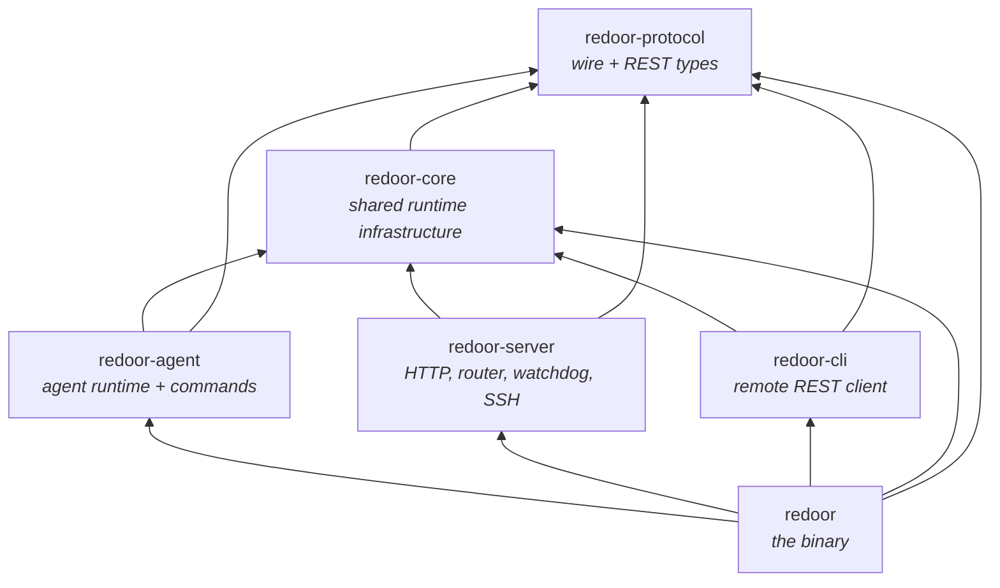
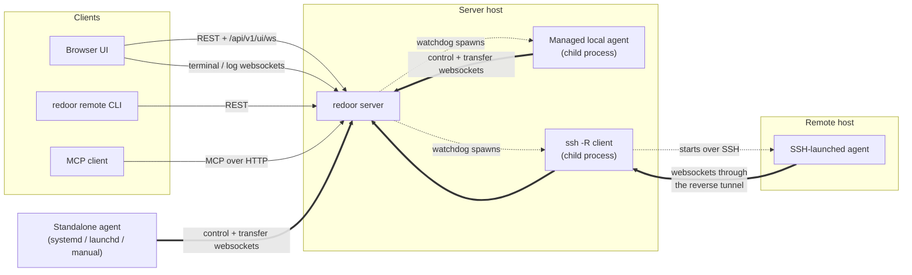
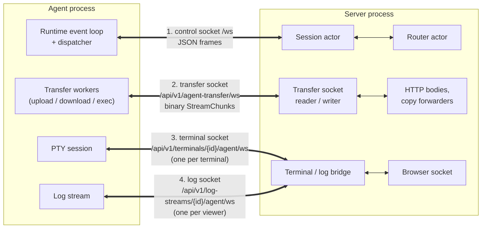
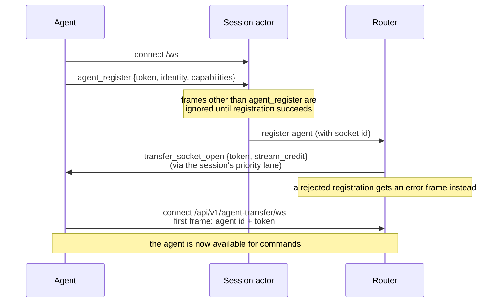
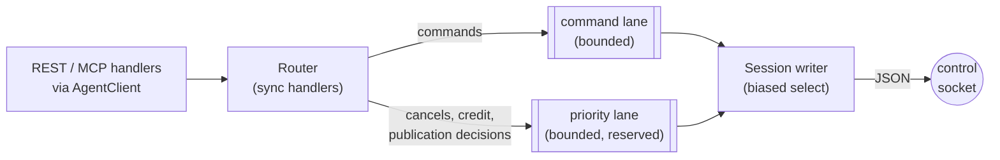
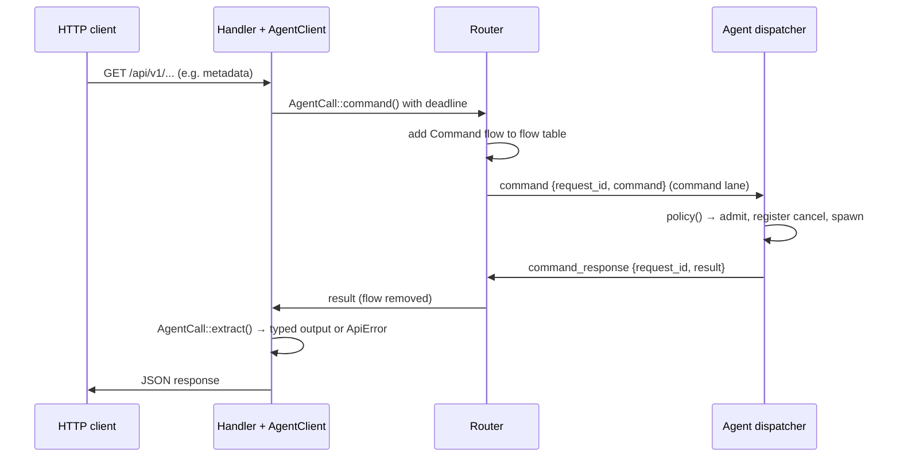
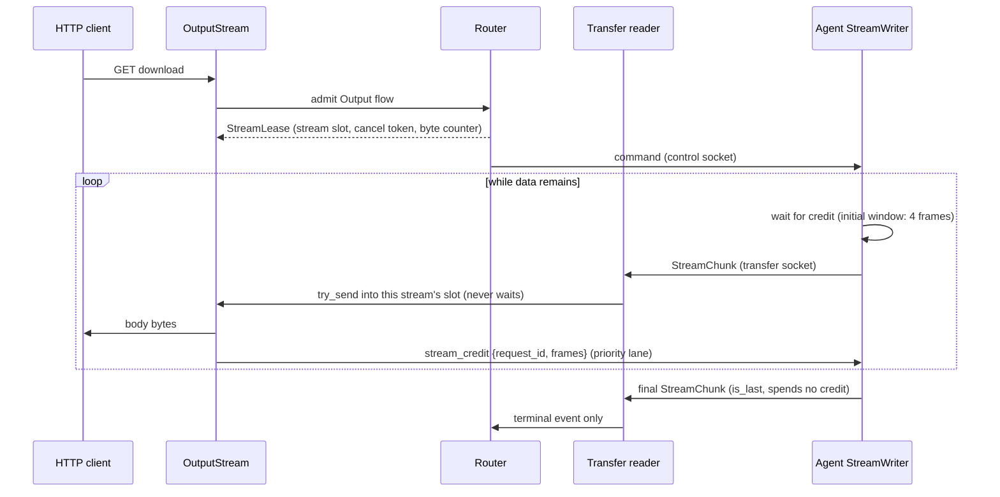
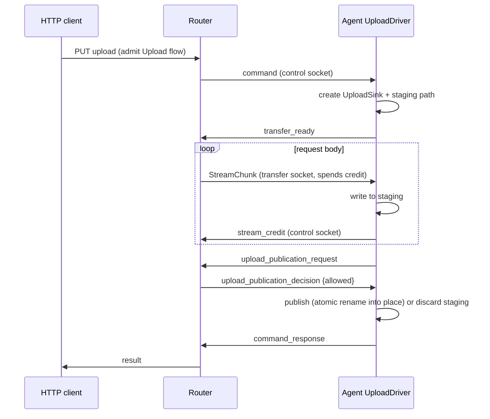
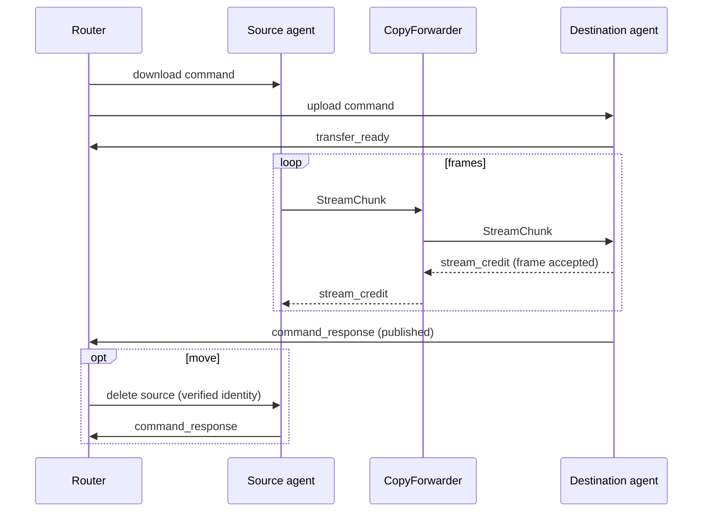
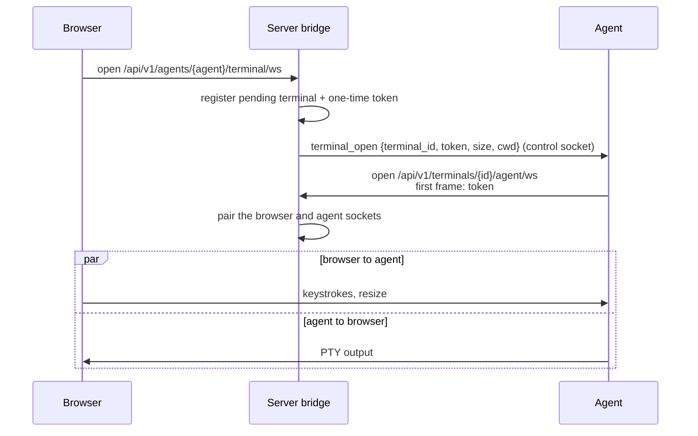

# Architecture

Redoor is a single `redoor` binary that plays several roles:

- **server**: REST API, browser UI, MCP endpoint and the websocket hub agents connect to
- **agent**: connects to a server and executes filesystem, exec, git, terminal and log commands on its host
- **remote CLI** (`redoor remote ...`): a REST client for scripting against a server
- **service management**: installs the server or agent as a systemd or launchd service

The Rust code is a cargo workspace under `crates/`. The roles live in separate crates so the
compiler enforces that agent and server code never depend on each other.

## Crates

Arrows point from a crate to what it depends on. Dependencies only go downwards, and the
three role crates in the middle are siblings that cannot import each other.

### `redoor-protocol`

The contract between all parties, with no runtime dependencies (no tokio).

- `wire/`: the agent websocket protocol.
  - `ServerToAgent` and `AgentToServer` are the control-socket envelopes, one per direction,
    so each side's `match` is exhaustive.
  - `Command` and `CommandResult` are the request and response payloads.
  - `Command::policy()` is the single table that classifies every command: which lane it
    uses, whether it needs the transfer socket, whether it is an upload, and how it is
    cancelled. Both the server and the agent read it, so they cannot disagree.
  - `stream` defines the binary `StreamChunk` framing (64 KiB frames) used on the transfer
    socket. `exec`, `log`, `terminal` and `transfer` hold the feature-specific wire types.
  - `registration` holds `AgentIdentity` and `AgentCapabilities`, which are flattened into
    the `agent_register` frame.
- `api/`: REST request and response types grouped by domain (agents, auth, files,
  transfers, git, mcp, ...).
- Types marked `#[ts(export)]` generate the TypeScript interfaces in `bindings/`, which the UI
  and the integration tests use. Wire and REST JSON is therefore checked from both sides.

### `redoor-core`

Infrastructure that more than one role needs:

- Configuration: serde parsing with a `validate()` pass, plus format-preserving edits through
  `toml_edit`.
- `RuntimeContext`: app name, `AppPaths` and websocket timeouts. It is built once in `main`
  and passed down instead of being read from process globals.
- Logging, behind a replaceable logger.
- Filesystem safety: `safe_fs` (including `safe_rm_all`), `atomic_rename`, `destination`
  (symlink-safe placement and merges) and `staging` (self-deleting hidden staging paths with
  atomic name reservation).
- `stream_credit`: the per-stream flow-control primitives that both the agent and server
  transfer paths use.
- Process helpers (`process`, `subprocess::run_checked`), `bounded_tail`, `paths::home()`,
  binary identity and build information.

### `redoor-agent`

The agent runtime and the implementation of every command.

- `runtime/`: the agent's single event loop.
  - `links`: the control and transfer websocket links, each with a generation number so
    events from a replaced socket are ignored.
  - `dispatch`: applies `Command::policy()` once per command. It handles admission,
    cancellation registration, spawning, logging and the response in one place.
  - `cancel`: a `CancellationToken` registry whose entries unregister themselves when dropped.
  - `responder`: typed outbound frames, including actions that must run after a frame was
    written (for example, re-exec after a restart response).
- `commands/`: filesystem, git, file search, content grep, metadata and host commands.
- `transfers/`: shared upload and download drivers.
  - `UploadSink` covers raw files, tar directories and file edits. `ByteSource` covers file
    ranges and tar archives.
  - Cancel and failure always run in the same order: stop, clean up, unregister, respond.
  - `stream` is the per-request writer, and the only place payload frames leave the agent.
    It waits for credit before each frame.
- `trash/`: a `TrashProvider` with freedesktop (Linux and Android/Termux), macOS and
  unsupported implementations.
- `platform/`: mounts, accounts and identity, which keeps OS-specific code out of the
  commands.
- `terminal`, `logs`: PTY sessions and log streaming over their own dedicated sockets.

### `redoor-server`

- `http/`: Axum routes, auth (sessions, PAM, machine and MCP tokens), the UI assets and MCP.
  - `agent_client`: typed `AgentCall`s with per-call deadlines defined in one place.
  - `error.rs`: `ApiError`, which owns all HTTP status mapping.
  - `services/`: `TransferService` (copy and move), `OutputStream` (downloads, diffs, exec)
    and `AgentUpload`. REST and MCP handlers are thin adapters over these.
- `actors/`:
  - `session`: one actor per agent control socket. It authenticates the registration and
    bridges the socket to the router through bounded lanes.
  - `lanes`: the typed outbound lanes to one agent: a command lane and a priority lane.
  - `router/`: the single owner of agent registrations and in-flight work.
    - `flows`: one table where every request belongs to exactly one flow (command, output
      stream, upload or copy), each with an explicit phase enum.
    - `streams`: the data path. Payload frames go from the transfer socket to consumers
      without passing through the router.
    - Every router handler is synchronous (enforced by `clippy::unused_async`), so the
      router mailbox never waits on a peer.
- `watchdog`: one dormant-until-started supervisor per managed agent, with restart backoff
  and generation counters.
- `ssh/`: preparing remote hosts (OS and architecture probe, binary install), launching
  agents through SSH reverse forwards, and the standalone `relay`.
- `startup`: `ServerConfig::resolve`, then `ServerRuntime::build`, then
  `serve_until_restart`.

### `redoor-cli`

The `redoor remote ...` client. It uses `reqwest` against the REST API with a saved session,
and covers device inventory, copy (including tar archives), exec and agent lifecycle. It only
depends on protocol and core, so it never links server or agent code.

### `redoor`

The binary crate. `main.rs` parses the CLI with clap and dispatches to a role. Every role
returns `anyhow::Result<ExitCode>`, and errors are printed once.

- `service/`: a `ServiceBackend` trait with systemd and launchd backends and one shared
  status formatter.
- `process_control` and `process_logs`: PID files, stopping processes and reading logs.
- The binary re-executes itself as the SSH askpass helper, so no second executable is
  shipped.

## Processes and connections

Agents always open the connections. The server never dials an agent, so an agent can run
behind NAT, on a phone (Termux) or on a host that is only reachable over SSH.

- **Standalone agents** are started by the user or a service manager, and connect to the
  server's `/ws` URL with an agent token.
- **Managed local agents** are `[[agents]]` entries in the server config. The server's
  watchdog spawns them as child processes and restarts them with backoff.
- **SSH-backed agents** are also watchdog-managed. The server runs `ssh -R
  <random-port>:<server>` and starts the agent on the remote host pointing at
  `ws://localhost:<random-port>/ws`. What looks like a local connection on the remote host
  reaches the server through the tunnel. The token is passed on SSH stdin and the password
  through askpass, so neither appears on a command line. `redoor agent relay` runs the same
  mechanism without a server, for agents of a remote server.
- **Browsers, the CLI and MCP clients** only use the REST API and browser websockets. They
  never talk to agents directly; the server translates each request into agent commands.

## Websockets used by one agent

Each agent keeps up to four kinds of websocket to the server:

1. **Control socket (`/ws`)**: JSON frames only. It carries registration, commands, command
   responses, cancels, stream credit, upload publication decisions and the requests to open
   terminal or log sockets. It never carries file contents, so commands stay responsive
   during large transfers.
2. **Transfer socket (`/api/v1/agent-transfer/ws`)**: binary `StreamChunk` frames tagged with
   their request id. It is persistent and shared by every upload, download, exec output and
   copy of that agent. Per-stream credit stops one stream from blocking the others.
3. **Terminal sockets**: one short-lived socket per open terminal, paired with the browser's
   terminal socket. PTY bytes are forwarded unchanged.
4. **Log sockets**: one short-lived socket per live log viewer, paired the same way.

Sockets 2–4 are opened by the agent only when the server asks over the control socket, each
time with a fresh one-time token. A stale or foreign connection therefore cannot attach to an
agent's streams.

## Connection setup

- The agent token proves the agent was started with server credentials. Until registration
  succeeds, the session drops every other frame. After that, it always uses its own
  registered agent id and never the one written in a frame. This stops an unauthenticated
  client from forging command results.
- Every connection gets a **socket id**. The router only accepts frames and unregistrations
  from an agent's *current* session, so a slow-dying old connection cannot remove the agent
  that replaced it after a reconnect.
- `stream_credit` is echoed only to agents that advertised `supports_stream_credit`. Both
  sides then switch to credit together. Older agents, and the fake agents in the tests, keep
  the uncredited behaviour.
- On the agent side, each link has a **generation** number. Timers and tasks from a replaced
  connection carry the old generation and are ignored.

## Server-side lanes to an agent

- Frames stay typed (`ServerToAgent`) until the session writer serializes them. JSON is
  produced in exactly one place per socket.
- The **command lane** is bounded. When it is full, new work is rejected instead of buffered,
  which is the server's admission control.
- The **priority lane** is drained first. Cancels, credit grants and publication decisions
  never wait behind a backlog of commands. Frames that must not be lost fall back to the
  command lane if the priority lane is momentarily full.
- The router never awaits. `RouterHandle::send` reports `Full` and `Stopped` separately, and
  async callers use `send_async`, so router messages are never silently dropped.

## One-shot command

- `AgentClient::call` is the only way handlers talk to agents. Each `AgentCall` defines its
  command, its deadline and how to extract the typed result. Wrong result types and errors
  become an `ApiError`, which maps to the HTTP status in one place.
- When the caller gives up (the deadline passes or the HTTP client disconnects), the router
  drops the flow. If the command can be cancelled on the agent, the router also sends
  `cancel_transfer` on the priority lane. A few commands, such as trash restore, are allowed
  to run to completion on purpose.

## Download, exec output and stream credit

- **Payload bypasses the router.** The router admits the stream and hands out a
  `StreamLease`. Frames then go from the transfer socket reader straight into that stream's
  bounded slot, and only the terminal event (done, failed or protocol violation) goes back to
  the router. Progress is read from the lease's byte counter.
- **Credit isolates streams.** The agent may have at most the granted number of frames in
  flight per stream (4 × 64 KiB). The server returns credit as the HTTP client drains the
  body. A stalled client therefore stalls only its own stream, while other downloads, exec
  output and copies from the same agent keep flowing. `tests/stream-isolation.test.ts`
  covers this.
- An agent that sends beyond its credit fails only that stream, not the socket.
- **Cancellation.** Dropping the `OutputStream` (the HTTP client went away) cancels the agent
  side through the lease. Final and error frames never need credit, so a cancel
  acknowledgement can never get stuck.
- Exec output uses the same path, and the exec exit result travels separately so it cannot
  be held up by unread output.

## Upload

- `transfer_ready` confirms the agent-side worker exists before any bytes cross the transfer
  socket.
- Content is written to a hidden **staging** path next to the destination. The path is
  reserved atomically and deletes itself if the upload is cancelled, fails or disconnects.
- **Publication is a separate step decided by the router.** This orders "publish" against a
  cancel that may be racing it. The router's answer is final, so a cancelled upload never
  replaces the destination, and an upload the router has accepted is never reported as
  cancelled.
- Raw file uploads, tar directory uploads and in-place file edits all use the same
  `UploadDriver`. They differ only in their `UploadSink`.

## Copy and move between agents

- A cross-agent copy is a source download and a destination upload joined by a
  `CopyForwarder` task. Credit is returned to the source only after the destination has
  accepted the frame. A slow destination therefore slows down only this copy, never either
  agent's other streams.
- A **move** is a copy followed by deleting the source (`CopyFlow` then
  `CopyPhase::DeletingSource`). The source is deleted only if its identity still matches what
  was copied. Once the source is being deleted, a destination disconnect no longer affects
  the result.
- A copy or move on a single agent runs entirely on that agent as a local worker. The server
  only follows its progress and can cancel it.

## Terminals and live logs

- Terminals and live log viewers each get a dedicated pair of sockets bridged by the server.
  Interactive traffic never shares a socket with bulk transfers.
- Browser input that arrives before the agent connects is buffered, within a frame and byte
  limit. Setup is abandoned if the agent does not connect in time.
- Live logs (`log_stream_open`, `/api/v1/log-streams/{id}/agent/ws`) use the same rendezvous.

## Design rules

- **Memory is bounded.** All uploads, downloads and tar archives are streamed in 64 KiB frames
  through bounded channels. Nothing reads a whole file into memory.
- **Control stays responsive.** Payload never uses the control socket or the router mailbox.
  The priority lane bypasses the command backlog, and per-stream credit stops one slow
  consumer from blocking others.
- **One owner per concern.**
  - `Command::policy()` classifies commands.
  - The router owns flow lifecycle.
  - `ApiError` owns HTTP status mapping.
  - Each socket writer is the only place that serializes JSON for its socket.
- **Stale events are ignored.** Socket ids on the server and generations on the agent mean a
  delayed event from a replaced connection can never affect its replacement.
- **The wire format is stable.** Message tags and field names are shared with the UI and the
  integration tests, which act as fake agents. New fields must be optional.
