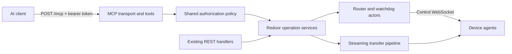

# Stateless MCP

Implement this plan with **three serial subagents**, one for each numbered section below. The coordinator starts the next subagent only after the previous subagent has completed its implementation, passed its required checks, and handed over the relevant modules, contracts, decisions, and test results. Each subagent builds on the preceding subagent's completed work. This plan revision does not start implementation.

Use published MCP **2026-07-28** as the initial protocol target. It incorporates SEP-2575 and subsequent changes. Keep Redoor's Rust/Axum server, agent WebSockets, and existing streaming transfer architecture. Every MCP request supplies its own bearer credential, protocol metadata, arguments, and any application operation identifier.

The three sections deliver configured bearer-token authentication. OAuth for clients requiring automatic sign-in, legacy protocol compatibility, filesystem-root confinement, and multiple-server deployment are follow-up work unless separately requested. Verify intended clients and SDK compatibility in section 1 and document those limits.

## 1. Authenticated hello-world MCP server and Vitest client

**Subagent 1 owns the protocol foundation, machine credentials, and test client.** Deliver a working authenticated MCP server with a harmless hello-world tool. This section has no UI, token-management REST APIs, or device-operation tools.

### Server and protocol

Add `POST /mcp` in a dedicated `src/server/mcp/` module. Separate transport validation, discovery, schemas, dispatch, and result/error mapping so section 2 can add tools without reimplementing the protocol.

- Implement `server/discover`, `tools/list`, and `tools/call`, initially exposing only `hello`. Return a bounded greeting in structured content and a short text summary. The tool must not access devices or mutate application state.
- An authenticated `tools/call` must work as the first request, without discovery or initialization. Advertise only implemented capabilities.
- Require protocol version and client capabilities in request `params._meta`. Client identity is optional, self-reported diagnostic information and cannot grant permissions. Include server identity in result metadata and `resultType: "complete"` in completed results.
- Validate `MCP-Protocol-Version`, `Mcp-Method`, and `Mcp-Name` where required against the body, including the specification's encoding rules. Use the specified JSON-RPC errors and HTTP statuses for missing/mismatched headers, unsupported versions, malformed requests, invalid arguments, and unknown methods/tools.
- Return JSON for the hello tool. Use explicit request/result size limits. Do not advertise subscriptions, resources, prompts, or server-to-client interactions that are not implemented.
- No initialization handshake, MCP session IDs, standalone GET event stream, or resumable SSE. Return 405 for GET/DELETE on `/mcp` and ignore legacy session headers without minting or echoing session IDs.
- Prefer a maintained Rust MCP SDK only after verifying support for this exact revision. An older SDK's "stateless HTTP" mode alone does not establish SEP-2575 compatibility. Keep any necessary protocol implementation small and schema-driven.

### Authentication foundation

Create a shared machine-token service that section 3 can call directly. Bootstrap credentials through a minimal administrative CLI using Redoor's private application storage; support creation, listing non-secret metadata, and revocation without a browser or management API. CLI mutations must be visible to a running server so revocation works without a restart; serialize durable updates safely across processes.

Token records contain a stable grant/owner identity, credential ID, name, verifier, scopes, device allowlist, creation/expiry/revocation metadata, and optional last-use information. Generate cryptographically random secrets, display them once, store only verifiers, verify in constant time, and protect storage permissions. Keep secrets out of source-controlled configuration and logs. Separate the grant identity from the replaceable credential so later rotation need not orphan authorized operations.

Every MCP request, including discovery and listing, requires `Authorization: Bearer <token>`. Resolve a principal and current grant afresh for every request. A valid token can call `hello` without device permissions. Define the scope/device policy model now; section 2 applies it to real operations. Never reuse agent registration secrets or accept browser cookies/passwords as MCP credentials.

Return 401 for missing/invalid/expired/revoked credentials and 403 for insufficient permission, with appropriate bearer challenges. Token storage and grant records are application state; they do not introduce an MCP protocol session.

Mount `/mcp` with its own required bearer middleware. The existing `src/server/auth.rs` public-path predicate treats paths outside `/api/` as public, so adding `/mcp` to the router alone would bypass browser authentication. Explicitly protect this boundary and preserve existing browser/agent authentication paths.

Validate Origin against configured origins when present, returning 403 for invalid origins while permitting origin-less native clients. Configure MCP CORS deliberately instead of inheriting the wildcard policy. Use HTTPS for remote access and loopback binding by default for local deployments. Add basic per-principal request/concurrency limits and audit credential ID, method/tool, timing, and outcome without recording secrets.

### Reusable Vitest MCP client

Add a small TypeScript client helper in `tests/` that connects to the real test server. Use the official TypeScript MCP SDK if it supports the selected stateless revision; otherwise use a thin HTTP helper implementing that revision's request/response contract. Keep it as test infrastructure rather than a separate production client.

Provide discovery, tool listing, and tool-call helpers. Allow independent client instances with different credentials and per-request metadata. Make the helper extensible for operation polling and any advertised SSE behavior in section 2. Register client/stream cleanup through `onTestFinished()`.

Use direct HTTP requests for malformed headers, missing metadata, unsupported versions, and other rejection cases: an SDK may prevent invalid requests from reaching the server. Keep these cases independent of the normal client's validation.

### Acceptance and handoff

- Vitest proves authenticated discovery/listing and a direct first-request `hello` call against the real server.
- Tests cover absent/invalid/expired/revoked tokens, cookie-only authentication, the non-API public-path exception, Origin checks, required metadata/header validation, unknown methods/tools, and independent requests from different clients.
- CLI-created credentials work with the server; revocation takes effect on subsequent requests. Secrets are absent from metadata listings and logs.
- Document a working hello-world client configuration and the supported protocol/client limitations.
- Run `mise exec -- pn test` with at least 1,200 seconds available for these code changes. Hand off the MCP extension points, token/grant service, CLI usage, and test-client helpers. Section 2 must reuse them; section 3 must expose the same token service through REST.

## 2. Actual MCP tools for devices and remote operations

**Subagent 2 owns every requested device tool and its backend behavior.** Start after section 1 is complete. Extend the established protocol, authentication, and Vitest client. Token-management UI and REST APIs remain in section 3.

### Shared architecture and existing functionality

Extract substantive domain services where REST handlers currently combine HTTP parsing with operations. Existing REST and new MCP handlers call these services directly, without loopback HTTP or one-line passthrough layers.

| Capability | Existing implementation to reuse |
| --- | --- |
| Device inventory/details and managed lifecycle | `src/server/agents.rs` and watchdog registry. |
| Non-PTY process execution | `src/server/exec.rs`, `src/exec_protocol.rs`. Current output is NDJSON and dropping the HTTP stream cancels execution. |
| Ranged reads and streamed writes | `src/server/raw.rs`, `src/server/raw/upload.rs`, `src/server/file_edit.rs`. |
| Same/cross-device copy and move | `src/server/copy.rs`, `src/server/moves.rs`, transfer progress/cancellation modules. |
| Delete, trash, directory creation, rename | `src/server/files.rs` and existing trash support. |
| Path and content search | `src/server/agents/files.rs`, `src/server/agents/content_grep.rs`, `src/commands/file_search.rs`, `src/commands/content_grep.rs`. |

Protocol statelessness does not make Redoor's deployment stateless: agent connections, watchdogs, credentials, transfers, and execution handles remain application state. Retain the current single-server topology. Multiple replicas would need shared authorization/operation storage and routing to each device's connection owner.

### Tool surface

| Tools | Inputs and behavior |
| --- | --- |
| `list_devices`, `get_device` | Stable `device_id`, display name, status, managed flag, default working directory, and supported features. Include permitted offline managed devices so they can be started. |
| `run_command` | Device, `argv`, absolute `cwd`, environment, deadline, output limit, and foreground/background mode. Use the existing executor; shell parsing is explicit through argv such as `["sh", "-lc", "..."]` with an available remote shell. |
| `get_operation`, `read_command_output`, `cancel_operation` | Explicit operation ID and bounded output offset/limit. Return operation state, exit/termination status, truncation, and cancellation acknowledgement. |
| `list_directory`, `stat_path` | Device and absolute path; bounded directory results and metadata without private configuration or download credentials. |
| `read_file` | Device, path, byte offset/limit, and text/binary encoding. Return bounded content, size, next offset, and whether more remains. |
| `write_file` | Device, path, bounded content, and explicit create/replace policy, preserving existing streamed upload/edit semantics. |
| `copy_path`, `move_path` | Source/destination `{device_id, path}`, including directories, and explicit destination conflict policy. Return an operation ID. |
| `delete_path` | Device, path, explicit trash/permanent mode and recursive intent. Reject unsupported trash mode. |
| `create_directory` | Device, absolute path, and necessary creation options. |
| `search_paths` | Existing query/root/timeout/hidden/gitignore/case options; bounded matches and partial-result indicators. Document existing matching behavior. |
| `search_contents` | Existing regex/fixed-string, case, hidden/gitignore, timeout, and context options; paths, line numbers, bounded text, and truncation/omission indicators. |
| `start_managed_agent`, `stop_managed_agent` | Stable device ID and existing watchdog desired-state semantics. Start reports acceptance, followed by polling for connection; stop reports cleanup completion or failure. Reject unmanaged devices. |
| `prepare_file_download`, `prepare_file_upload` | Device/path and an authenticated streaming endpoint or narrowly scoped temporary transfer grant for bytes moving between the AI runtime and a device. |

Publish input/output JSON Schemas and structured results with concise summaries. Mark read-only/destructive tools accurately; client approval annotations never replace server authorization. Retain `hello` as a harmless smoke-test tool.

Require absolute paths and explicit device IDs on every filesystem call, with no implicit current device/directory retained between requests. Default to non-overwriting behavior and require explicit replacement/destructive modes. Recursive deletion must reuse `safe_rm_all`. Inventory must not expose passwords, tokens, SSH private configuration, or one-time credentials.

### Authorization

Apply section 1's grants to each tool and every later operation/output/streaming request. Filter discovery of devices and operation results so unauthorized resources are not disclosed.

| Scope | Access |
| --- | --- |
| `devices:read` | Authorized inventory, device status, and details. |
| `files:read` | Listing, metadata, reads, searches, and downloads. |
| `files:write` | Writes, uploads, directory creation, and copy destinations. |
| `files:delete` | Trash/permanent removal and source removal during moves. |
| `commands:execute` | Arbitrary execution on allowed devices. |
| `agents:manage` | Start/stop allowed managed agents. |

Combine scopes with explicit device grants. Copy requires source read and destination write; move additionally requires source deletion. Bind operations to their owning account/grant and recheck current permissions for retrieval and cancellation. Restrict cancellation to the owner or an explicitly authorized administrator.

Arbitrary execution has the power of the device agent's OS account and can bypass file-tool scopes. Treat `commands:execute` as a separate high-trust grant. Restricted OS users/containers are necessary for stronger execution isolation. Optional filesystem-root confinement requires agent-side canonical/symlink-aware enforcement, including search traversal and archive extraction; server string-prefix checks are insufficient.

### Execution, transfers, and memory limits

Foreground commands have bounded deadlines/output. After the retained output limit, continue draining the stream and mark truncation. Return stdout/stderr and actual exit/termination status. Disconnect cancels foreground work; successful admission or partial output does not establish completion.

Background commands return a principal-owned operation ID after admission. The operation owns execution independently of the completed MCP request. Stream retained output into a private disk spool with per-job/global quotas, expiry, and bounded read pages. Cancellation acceptance is distinct from the agent's termination acknowledgement. Following server restart, unrecoverable running records become interrupted/unknown; never claim success or automatically repeat the command.

Reuse existing copy/move progress and cancellation. Preserve atomic same-filesystem rename and cross-device copy-then-delete guarantees. Report partial outcomes such as "destination copied, source retained" when cleanup fails. Cancellation must not delete the only surviving copy.

Set configurable request/result limits, for example 64 KiB inline file content, and reuse ranged streaming for larger reads. Stream writes into the upload/edit pipeline and wait for completion acknowledgement. Never buffer an entire large file, archive, command log, or transfer in memory. Bound listings/search results too.

For device-to-device transfers, reuse the existing streaming pipeline instead of embedding bytes in MCP results. For AI-runtime transfers, provide authenticated streaming endpoints and document that the client must perform the transfer. Provide chunked file-tool access for clients limited to MCP calls. Temporary grants, if needed, bind principal/device/path/direction, byte limits, expiry, and conflict policy; treat their URLs as secrets. Avoid unrestricted URL-fetch tools.

Preserve backpressure and separate transfer/control paths so large transfers do not block cancellation, shell control, inventory, or lifecycle. Existing searches can supersede earlier searches on an agent: add request-specific cancellation so concurrent MCP/UI searches remain independent, preserving current ignore/context/timeout/truncation behavior.

Support optional principal-scoped idempotency keys for mutations, bound to the full normalized request. Persist admission records and return the original operation/result on retries; reject key reuse with changed arguments. JSON-RPC request IDs are not idempotency keys. Preserve ambiguous outcomes instead of retrying destructive actions automatically; do not promise exactly-once remote side effects across crashes.

If SSE is implemented, scope it to a single POST, include only permitted request-related notifications, and terminate with the final result. Stream closure cancels that request. Background operation cancellation remains an explicit tool call. Poll device/operation status instead of adding subscriptions initially.

### Acceptance and handoff

- Extend the Vitest client with operation polling and implemented streaming support. Test every tool against real server/agent processes, including two-device moves, shell output/exit status, file read/write/delete, search, and managed lifecycle.
- Test action/device grants, both sides of transfers, another grant's operation/output, revoked/expired permissions, and direct streaming access. Preserve section 1's protocol/authentication tests.
- Test large files/directories, bounded memory/output, slow consumers, concurrent control, cancellation/disconnect, conflicts, failed source cleanup, idempotent retries, and crash ambiguity.
- Test independent simultaneous searches and supported Linux/macOS/Termux behavior, including shell availability and filesystem/trash capabilities. Exercise an intended MCP client end to end.
- Keep distinct new REST endpoints in dedicated domain modules. New REST responses use `#[ts(export)]`; regenerate bindings after exported type changes.
- Run `mise exec -- pn test` with at least 1,200 seconds available. Hand off the final tool/scope catalog, operation/grant ownership rules, device inventory contracts, and MCP connection examples for section 3's UI.

## 3. Token-management REST APIs and UI

**Subagent 3 owns the management APIs and required UI.** Start after section 2 is complete. Reuse section 1's token/grant service and section 2's scopes/device model; token management must not become an MCP tool or require a second credential store.

### REST API

Create a dedicated token-management module, with account-owned endpoints such as:

| Endpoint | Responsibility |
| --- | --- |
| GET `/api/v1/mcp/tokens` | List non-secret token metadata: IDs/names, grants, scopes/devices, expiry, revocation, and available last-use information. |
| POST `/api/v1/mcp/tokens` | Validate a named scope/device grant and expiry, create a token, and return its secret exactly once. |
| DELETE `/api/v1/mcp/tokens/{token_id}` | Revoke the credential so later MCP and streaming requests reject it. |
| POST `/api/v1/mcp/tokens/{token_id}/rotate` | Atomically issue a replacement credential and invalidate the old one; return the new secret once and preserve stable grant ownership. |

Protect these endpoints with the existing browser account authentication and appropriate mutation Origin/CSRF protection. An MCP bearer credential alone must not authorize credential creation, grant escalation, or rotation. Restrict management to the owning account and validate device IDs, scopes, expiry, and names. Never return stored verifiers or recover old secrets; token responses must not be cached.

The CLI and API must see the same durable state. Define rotation so failed issuance does not revoke a still-valid credential, and successful rotation immediately rejects the old credential. Preserve authorized operation access through stable grant identity, subject to current permissions.

Use dedicated `#[ts(export)]` request/response types where appropriate and regenerate bindings with `mise exec -- scripts/generate-ts-bindings`. Add client methods in `ui/src/api-client.ts` using those generated bindings.

### UI workflow

Add a discoverable MCP token-management settings page, following the existing navigation/settings patterns. Provide:

- A token list showing name, scope/device summary, expiry, last use when available, and active/expired/revoked status.
- A create workflow with a name, expiry, read-only default scopes, and explicit device selection. An empty device allowlist grants no device access; broad access requires an explicit choice.
- Clear descriptions for file read/write/delete and managed-agent control. Explain that shell execution can read/modify/delete files regardless of file-tool scopes, and require an explicit choice to enable it.
- A one-time secret display after create/rotate, with user-triggered copy and concise instructions using the MCP endpoint and bearer header. Show secrets only in the immediate creation/rotation workflow; avoid persistent browser storage, URLs, analytics, and list/query caches.
- Revoke and rotate workflows using the existing confirmation/dialog components, with success/error feedback and refreshed token metadata. Explain that rotation invalidates the old token.
- Loading, empty, failure, and expired/revoked states. Clear transient secret state when its workflow closes or the page unmounts.

Use TanStack Router loaders to prime initial query data, TanStack Query for interactive reads/mutations, and the shared API client. Do not fetch APIs from `useEffect`. Follow Tailwind and the existing reusable `Button`, form controls, `Dialog`, `ConfirmationDialog`, `Toast`, `Tooltip`, and copy components. Use accessible labels and avoid native buttons/inputs where shared controls exist.

This section manages configured tokens. OAuth sign-in is a later integration: it would require Protected Resource Metadata, authorization-server discovery, authorization code with PKCE, resource-bound tokens, and issuer/audience/scope checks mapped to the same policy. The token-management UI must not imply that automatic OAuth sign-in is already supported.

### Acceptance and handoff

- Vitest integration tests cover every management REST endpoint, ownership, unauthenticated access, MCP-token-only rejection, invalid scopes/devices/expiry, one-time secrets, persistence, revocation, and atomic rotation.
- Playwright covers the primary create → copy/configure → use → rotate/revoke workflow. Use the MCP test client to prove created credentials work, scoped device access is enforced, rotated credentials work, and old/revoked credentials fail.
- Cover form defaults, explicit shell permission, device selection, failed mutations, and secret-free listing/navigation. Select controls by role/accessibility text rather than CSS classes.
- Build the UI after route changes to regenerate route types, regenerate exported bindings, and run `mise exec -- pn test` with at least 1,200 seconds available.
- Hand off user-facing MCP setup instructions and report all three sections' completed behavior and validation. No implementation work from earlier sections may remain implicitly deferred to the UI stage.

### Test hygiene for all three subagents

Use observable status/API polling instead of sleeps, `onTestFinished()` for per-test Vitest cleanup, and comments explaining assertions. Inspect `./log` on failures and record transient tests that pass on rerun in `./flaky-tests.md`. Apply the repository's platform, async API, streaming, and reusable-component rules throughout. Documentation/plan/comment-only edits do not require tests or builds.

### References for all three subagents

Reviewed 2026-10-04. The pinned published specification is authoritative; SEP examples alone are not the final wire contract.

- [SEP-2575: Stateless MCP](https://modelcontextprotocol.io/seps/2575-stateless-mcp)
- [MCP 2026-07-28 basic protocol and metadata](https://modelcontextprotocol.io/specification/2026-07-28/basic)
- [Streamable HTTP and required headers](https://modelcontextprotocol.io/specification/2026-07-28/basic/transports/streamable-http)
- [Server discovery](https://modelcontextprotocol.io/specification/2026-07-28/server/discover)
- [Authorization](https://modelcontextprotocol.io/specification/2026-07-28/basic/authorization)
