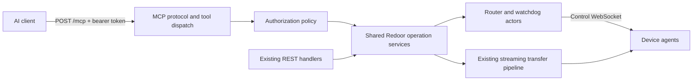

# Stateless MCP

## Recommendation

Add an authenticated `POST /mcp` endpoint to the existing Rust/Axum server. Expose Redoor's device, command, filesystem, search, and managed-agent operations as MCP tools backed by the same services as the REST API. Keep the agent WebSocket architecture and streaming transfer implementation.

Use the published MCP **2026-07-28** specification as the initial protocol target. It incorporates SEP-2575, removes initialization and protocol sessions, and includes changes made after the SEP became final. Each request carries its own authentication, protocol metadata, tool arguments, and any operation identifier.

Start with scoped, revocable personal access tokens for AI clients that accept a configured authorization header. Add standard OAuth discovery and authorization for clients that require automatic sign-in. Both should resolve to the same authorization policy.

## Existing foundations and gaps

| Capability | Existing implementation | Work needed for MCP |
| --- | --- | --- |
| Device inventory and details | `src/server/agents.rs`; GET `/api/v1/agents` and `/agents/{agent}` | Filter inventory by credential permissions; return stable agent IDs, status, working directory, managed status, and supported features. |
| Process execution | `src/server/exec.rs`, `src/exec_protocol.rs`; POST `/agents/{agent}/exec` | Adapt argv-based execution to bounded MCP results; add operation-backed execution for long jobs. Current REST output is NDJSON, and disconnect cancels the process. |
| Read and write files | `src/server/raw.rs`, `src/server/raw/upload.rs`, `src/server/file_edit.rs` | Reuse ranged downloads and streamed upload/edit behavior; expose bounded content and streamed bulk-transfer access. |
| Copy and move | `src/server/copy.rs`, `src/server/moves.rs`, transfer progress/cancellation modules | Reuse same-device and cross-device operations; bind transfer IDs to the authenticated principal and report terminal status. |
| Delete and directories | `src/server/files.rs` | Reuse trash/permanent deletion, directory creation, and rename semantics with explicit arguments. |
| Path and content search | `src/server/agents/files.rs`, `src/server/agents/content_grep.rs`, `src/commands/file_search.rs`, `src/commands/content_grep.rs` | Preserve existing matching and ignore options; bound responses and isolate concurrent searches. |
| Managed-agent lifecycle | `src/server/agents.rs` and watchdog registry | Reuse managed start/shutdown behavior and report accepted versus connected/stopped status. |
| Authentication | `src/server/auth.rs` | Current authentication uses a single browser account, durable session cookies, and a separate agent registration secret. Add machine credentials and per-operation authorization. |

Two existing behaviors need particular attention: new searches can supersede previous searches on an agent, and execution results cannot currently be fetched after the HTTP stream closes. Concurrent AI clients require request-specific search cancellation and explicit execution handles.

## Architecture

Create a dedicated `src/server/mcp/` module for transport validation, discovery, schemas, tool dispatch, and result/error mapping. Extract substantive execution, filesystem, transfer, search, and lifecycle services where REST handlers currently combine HTTP parsing with domain behavior. REST and MCP should call those services directly; avoid loopback HTTP calls and passthrough wrapper layers.

Keep transport concerns separate from authorization and agent operations. Existing browser routes can retain their cookie policy, while MCP and its bulk-transfer routes require machine credentials. New REST responses need dedicated `#[ts(export)]` types and generated bindings.

Protocol statelessness does not make the entire Redoor deployment stateless. Device connections, watchdogs, transfers, credential records, and execution handles remain application state. A first release can retain the existing single-server topology. Multiple server replicas would additionally require shared authorization/operation storage and routing to the server that owns each device connection.

## Protocol contract

- Implement `server/discover`, `tools/list`, and `tools/call`. Advertise only implemented capabilities. Discovery is optional for clients; an authorized `tools/call` must work as the first request.
- Require the version and client capabilities in request `params._meta`. Client identity is optional and useful for diagnostics; it is self-reported and cannot grant permissions. Include server identity in result metadata and `resultType: "complete"` in completed results.
- Validate `MCP-Protocol-Version`, `Mcp-Method`, and `Mcp-Name` where required against the body, including the specification's encoding rules. Handle missing/mismatched headers, unsupported versions, invalid parameters, and unknown methods using the specified JSON-RPC errors and HTTP statuses.
- Return JSON for ordinary tool results. Optional SSE responses must be scoped to one POST, carry only permitted request-related notifications, and end with the final result. No initialization handshake, MCP session IDs, standalone GET event stream, or resumable SSE.
- Return 405 for GET/DELETE on `/mcp`. Application operation cancellation is a tool call, separate from cancelling an SSE request by closing its stream.
- Keep the initial tool catalog stable. Poll device/operation tools instead of implementing subscriptions. Add `subscriptions/listen` only if change notifications become necessary; do not claim that capability initially.
- Prefer a maintained Rust MCP SDK after verifying support for this exact protocol revision. An SDK's older "stateless HTTP" mode alone does not establish SEP-2575 compatibility. Keep any necessary protocol implementation small, schema-driven, and covered by conformance tests.
- Publish input/output JSON Schemas and structured results with a short text summary for clients. Mark read-only/destructive tools accurately; annotations help client approval UX but never replace server authorization.

Older MCP clients may still require initialization. Verify intended clients early. If compatibility is needed, add a version-specific adapter using the same tools and services; keep legacy semantics out of the modern protocol path.

## Initial tool surface

| Tools | Inputs and behavior |
| --- | --- |
| `list_devices`, `get_device` | Stable `device_id`, display name, connection/lifecycle state, managed flag, default working directory, and feature support. Include permitted offline managed devices so they can be started. |
| `run_command` | `device_id`, `argv`, absolute `cwd`, environment, deadline, output limit, and foreground/background mode. Use the existing non-PTY executor. Shell syntax is explicit through an argv such as `["sh", "-lc", "..."]`, with a shell available on that device. |
| `get_operation`, `read_command_output`, `cancel_operation` | Explicit operation ID; output offset/limit where relevant. Return pending/running/succeeded/failed/cancelled/interrupted state, exit status, bounded output, truncation, and cancellation acknowledgement. |
| `list_directory`, `stat_path` | `device_id` and absolute remote path; bounded directory results and existing metadata without download credentials or private configuration. |
| `read_file` | `device_id`, path, byte offset and maximum bytes, and text/binary encoding. Return content, next offset, size, and whether more remains. |
| `write_file` | `device_id`, path, bounded text or binary content, and explicit create/replace policy. Use the existing streaming write machinery and preserve edit semantics. |
| `copy_path`, `move_path` | Source and destination `{device_id, path}`, including directories; explicit destination conflict policy. Return an operation ID. |
| `delete_path` | `device_id`, path, explicit trash/permanent mode and recursive intent. Require the stronger delete permission for permanent removal; reject unavailable trash mode. |
| `create_directory` | `device_id`, absolute path, and necessary creation options. |
| `search_paths` | Existing path-search query, root, timeout, hidden-file, gitignore, and case options; bounded matches and partial-result indicators. Document the existing matching behavior. |
| `search_contents` | Existing regex/fixed-string, case, hidden-file, gitignore, timeout, and context options; paths, line numbers, bounded text, and existing truncation/omission indicators. |
| `start_managed_agent`, `stop_managed_agent` | Stable `device_id`; existing watchdog desired-state semantics. Starting reports acceptance, followed by polling for connection. Stopping reports cleanup completion or failure. Reject unmanaged devices. |
| `prepare_file_download`, `prepare_file_upload` | Identify a device/path and return an authenticated streaming endpoint or a narrowly scoped temporary transfer grant for moving bytes between the AI runtime and a device. |

Use absolute paths and explicit device IDs on every filesystem call; never retain an implicit current device or working directory between requests. Require explicit destructive modes and replacement policies, with non-overwriting behavior as the default. Device listing must not expose passwords, tokens, SSH private configuration, or one-time download credentials.

## Commands, transfers, and bounded memory

For short foreground commands, collect output only up to a configured byte limit while continuing to drain the process stream. Return stdout/stderr, exit code or termination reason, and truncation. Enforce a bounded deadline. A closed request cancels foreground execution; partial output or a successful admission is not proof of successful completion.

For background commands, return a principal-owned operation ID after admission. The operation owns execution independently of the completed MCP request, so later calls can read output or cancel it. Store retained output in a private, streamed disk spool with per-job/global quotas and expiry, and bounded read pages. Cancellation acceptance must remain distinct from the agent's acknowledgement that the process has terminated. On server restart, retained running records become interrupted/unknown unless recovery can establish their actual status; never claim success or repeat the command automatically.

Copy/move already run as explicit application operations. Reuse transfer progress and cancellation, exposing only authorized handles. Preserve atomic same-filesystem rename and existing cross-device copy-then-delete guarantees. Report partial outcomes clearly, including "destination copied, source retained" when source cleanup fails. Cancel operations safely without deleting the only surviving copy.

MCP JSON should carry small content and control information. Set configurable request/result limits, for example an initial 64 KiB inline file limit, and use ranged streaming for larger reads. Never read an entire large file, archive, or command log into memory. Stream writes into the agent upload/edit pipeline; use existing completion acknowledgements before reporting success.

For large files between devices, route bytes through the existing transfer pipeline without embedding them in MCP results. For transfers involving the AI runtime, use authenticated HTTP streaming endpoints. A URL is useful only if the client can perform that transfer; document this requirement and provide chunked file-tool access for clients with only MCP tools. Temporary grants, if necessary, must be short-lived and bound to principal, device, canonical path, direction, byte limits, and conflict policy. Treat grant URLs as secrets and avoid logging them. Do not add unrestricted URL-fetch tools.

Keep bounded buffers and backpressure throughout raw/tar pipelines, and retain separate transfer/control paths so large transfers cannot block cancellation, shell control, inventory, or lifecycle calls. Bound directory listings and search results too. Preserve existing search limits and partial-result fields; add per-request cancellation so unrelated MCP calls and UI searches cannot silently supersede one another.

Support an optional idempotency key for mutating tool calls, scoped to the authenticated principal and full normalized request. Persist admission records and return the original operation/result on retries; reject reuse with different arguments. A JSON-RPC request ID alone is not an idempotency key. Ambiguous failures must remain ambiguous rather than automatically repeating a command, overwrite, or move. Do not promise exactly-once remote side effects across crashes.

## Authentication and authorization

### First release: dedicated machine tokens

Create named tokens through an authenticated account-management API/UI or an administrative CLI. Show each secret once; store only a verifier plus token ID, owner, allowed actions/devices, expiry, revocation state, and audit metadata. Use cryptographically random secrets, constant-time verification, restrictive storage permissions, and explicit rotation/revocation. Keep tokens out of source-controlled configuration and logs.

Every MCP request sends `Authorization: Bearer <token>`. Validate the credential and authorization afresh, including discovery/listing. Use the same policy for operation lookup, output reads, cancellation, and streaming endpoints. Never reuse the agent registration token or require AI clients to retain browser login cookies/passwords.

Return 401 for missing/invalid credentials and 403 for insufficient permission, with appropriate bearer challenges. Do not expose unauthorized devices or operation existence. A personal access token mode supports explicitly configured clients; it is not the full interoperable MCP OAuth sign-in flow.

### Permissions

| Permission | Access |
| --- | --- |
| `devices:read` | Authorized inventory, status, and details. |
| `files:read` | Listing, metadata, reads, path search, content search, and downloads. |
| `files:write` | Writes, uploads, directory creation, and copy destinations. |
| `files:delete` | Permanent removal and the source-removal part of moves. |
| `commands:execute` | Arbitrary execution on selected devices. |
| `agents:manage` | Start/stop selected managed agents. |

Combine action scopes with a device allowlist; default to read-only grants. A cross-device copy requires source read and destination write; a move additionally requires source deletion. Bind operations to their owning account/credential grant and recheck current device/action permissions on subsequent calls. Restrict cancellation to the owner or an explicitly authorized administrator.

Optional filesystem-root restrictions require agent-side canonical/symlink-aware enforcement, including search traversal and archive extraction. A string-prefix check on the server is insufficient, especially because existing searches can follow directory symlinks. Treat root confinement as a separate implementation increment with adversarial tests.

**Arbitrary shell access gives the client the power of the device agent's OS account.** A token with `commands:execute` can read, modify, or delete files through shell commands regardless of file-tool scopes. Present it as a separate high-trust grant; enforce stronger isolation with a restricted OS user/container if required. Tool-specific scopes cannot sandbox an unrestricted shell.

### OAuth for automatic client sign-in

For broad remote-client support, implement MCP's OAuth 2.1 resource-server flow, preferably with a maintained authorization server/provider. Publish RFC 9728 Protected Resource Metadata and advertise it through `WWW-Authenticate`; supply authorization-server discovery. Use authorization code with PKCE for interactive clients, exact registered redirect URIs, and resource-bound access tokens. Verify issuer, audience/resource, expiry, and granted scopes on every request. Map identities/grants to Redoor's account and device policy.

Support client registration mechanisms according to the selected MCP revision and provider; begin with pre-registered clients if that covers the intended clients. Use a provider-supported machine grant for unattended clients or the dedicated token mode. Do not forward Redoor access tokens to agents or other services. OAuth authentication state and durable grants are compatible with a stateless MCP protocol.

Redoor currently has one browser login account. External identities must be explicitly mapped to that account's grants; multi-user sharing is a separate feature. Avoid building a general-purpose identity system solely to expose MCP.

### HTTP integration and audit

Mount `/mcp` with its own required bearer middleware. The current `is_public_path` treats paths outside `/api/` as public, so merely adding `/mcp` to the existing router would bypass browser authentication. Explicitly test this boundary, and keep machine-token routes separate from cookie-authenticated account management.

Validate Origin against configured origins when present, with 403 for invalid origins; permit origin-less native clients. Configure MCP CORS deliberately rather than inheriting wildcard policy. Use HTTPS for remote access, a configured canonical public URL for OAuth, and trusted-proxy settings. Local deployments should bind to loopback by default.

Audit credential ID/owner, tool, authorized devices/paths, operation ID, timing, and outcome. Exclude credentials, file contents, environment values, and command output by default. Add per-principal concurrency/rate limits and disk/output quotas. Treat searched files and command output as untrusted tool data; client-side confirmation remains the client's responsibility.

## Delivery phases

1. **Protocol and client compatibility:** confirm target AI clients and SDK support; implement modern request validation, discovery, tool catalog, bounded results, and error mapping. Add conformance tests proving direct first-request calls and metadata isolation.
2. **Machine authentication and shared services:** implement token management, principals, scopes/device grants, audit, and the dedicated MCP router. Extract domain operations needed by both REST and MCP. Land inventory, listing/metadata, and existing searches, including cancellation isolation.
3. **Files and transfers:** deliver bounded read/write, delete/mkdir, same/cross-device copy/move, operation ownership, polling/cancellation, and authenticated streaming upload/download. Cover conflict, permissions, disconnect, and partial-failure behavior.
4. **Execution and lifecycle:** deliver foreground/background commands, bounded output spooling and retention, idempotent admission, operation recovery semantics, and managed start/stop. Verify large transfer and command output cannot starve control traffic.
5. **Client integration:** document endpoint/token configuration and primary AI workflows. Add token-management UI coverage if the UI is included. Add OAuth discovery/provider integration before claiming compatibility with clients that require automatic sign-in; add legacy protocol support only where needed.

Each phase should expose a coherent working subset with permissions and tests in place. Completion of the requested feature includes all tools above, not just protocol discovery.

## Verification and acceptance

- TypeScript/Vitest integration tests cover every tool and any new REST feature against real Redoor server/agent processes, including two-device moves, shell output/exit status, read/write/delete, search options, and managed lifecycle.
- Protocol tests cover a `tools/call` without discovery, independent requests from different clients, required metadata/header validation, current result schemas, unsupported versions/methods, and ignored legacy session headers.
- Authorization tests cover no token, expired/revoked token, wrong scopes/device, cross-device permissions, another principal's operation/output, direct streaming access, cookie-only MCP calls, and the existing non-API public-path exception. OAuth adds discovery, PKCE/provider integration, wrong issuer/audience, and scope challenges.
- Streaming tests cover large files/directories, bounded memory/output, slow consumers, concurrent control commands, cancellation, disconnects, destination conflicts, and failed source cleanup. Test retries and crash ambiguity without duplicate destructive admission.
- Search tests prove independent concurrent calls and preserve existing hidden/gitignore/context/timeout/truncation behavior. If path confinement is added, include symlink escape and archive-entry escape tests.
- Verify advertised Linux/macOS/Termux behavior, especially shell availability, filesystem/trash support, and managed-agent restrictions. Exercise at least one intended MCP client end to end.
- Use observable status/API polling rather than sleeps, `onTestFinished()` for per-test cleanup, and comments explaining assertions. Run generated bindings after exported Rust type changes and the UI build after route changes. Add Playwright coverage for the primary token-management workflow if introduced.
- Finish implementation with `mise exec -- pn test`, allowing at least 1,200 seconds. Inspect `./log` on failures and record tests that fail transiently and pass on rerun in `./flaky-tests.md`.

## Sources

Reviewed 2026-10-04. Use the pinned published specification for implementation; SEP examples alone are not the final wire contract.

- [SEP-2575: Stateless MCP](https://modelcontextprotocol.io/seps/2575-stateless-mcp)
- [MCP 2026-07-28 basic protocol and metadata](https://modelcontextprotocol.io/specification/2026-07-28/basic)
- [Streamable HTTP and required headers](https://modelcontextprotocol.io/specification/2026-07-28/basic/transports/streamable-http)
- [Server discovery](https://modelcontextprotocol.io/specification/2026-07-28/server/discover)
- [Authorization](https://modelcontextprotocol.io/specification/2026-07-28/basic/authorization)
